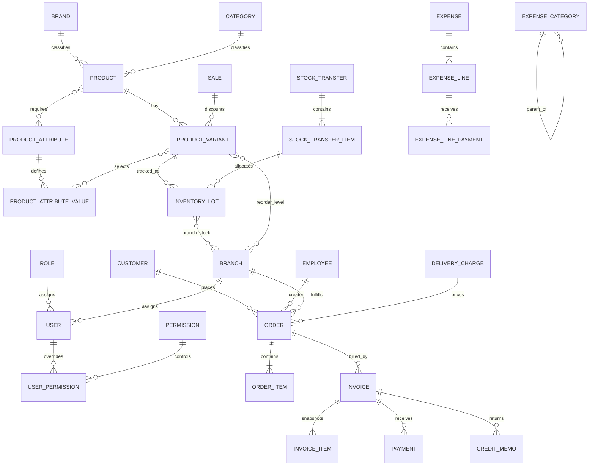

# Stockify REST API and Frontend Product Guide

This document is a source-derived contract for building the Stockify frontend. It describes the API as implemented in `Server`, the business workflows implied by that implementation, and the UI behavior needed to integrate with it safely.

> Source of truth: controllers, request DTOs, entity models, services, middleware, EF configuration, and seed data in this repository. This is not a redesign. Where implementation details are surprising or inconsistent, they are called out explicitly.

## 1. Product overview

Stockify is a multi-branch inventory, order, POS, invoicing, expense, and reporting system. Its central product concepts are:

- Users sign in, belong to a role and branch, and receive granular permissions.
- Products are reusable catalog records. Sellable SKUs are product variants made from attribute values such as size or color.
- Physical stock is held per branch and per inventory lot. Aggregate stock shown in the UI is derived from those lot balances.
- Orders immediately reserve/deduct stock, create an invoice, and snapshot pricing, sale discounts, order discounts, tax, and delivery fees.
- Invoice payments move both invoice and order statuses. Returns create credit memos and restore the original lot stock.
- Stock transfers have a draft → sent → partially received/completed → discrepancy resolution workflow.
- Expenses contain heterogeneous lines, optional currency/employee/branch context, and payments that require an approval/rejection decision.
- Dashboards aggregate stock, transfers, paid revenue, expenses, top products, and demand. Reports download `.xlsx` files.

### Implied primary screens

| Screen | Main UI | Data/actions |
|---|---|---|
| Sign in | Username/password form | Login, retain/rotate refresh token, redirect by permissions |
| Dashboard | Date filters, branch selector, KPI cards, tables and charts | Stock alerts, transfers, expenses, revenue, top products, demand trend |
| POS / order composer | Scan/search input, cart, customer, salesperson, delivery, discount and totals | Scan SKU/barcode, validate branch stock, submit one order |
| Orders | Search/filter table and detail drawer/page | Ship, deliver, cancel; link to invoice |
| Invoices | Search/filter table and invoice detail | Record payment, show balance/history, return items, show credit memos |
| Products | Product table, product form/detail, variant subtable | Configure tracking/attributes, create/edit/delete variants |
| Attributes | Attribute/value manager | CRUD attributes and their values |
| Inventory | Lot table, variant-by-branch stock detail, adjustment history | Create lot, add/remove stock, edit/reverse adjustments, set reorder level |
| Transfers | Transfer table, statistics, detail workflow | Request, dispatch by lot, receive cumulatively, cancel, resolve discrepancies |
| Sales | Promotion table/detail | Create date-bound promotion and associate variants via variant editing |
| Expenses | Expense table/detail, dynamic line form, payment approval UI | Create multi-line expense, submit/delete pending payments, approve/reject |
| People/settings | Users, permissions, employees, customers, branches, brands, categories, delivery fees | CRUD and relationship-safe delete behavior |
| Reports | Report cards with relevant filter forms | Download Excel files and surface binary-download failures |

## 2. API conventions

### Base URL and content types

- All routes below are relative to the deployed server origin, for example `https://stockify.example/api/products`.
- JSON requests use `Content-Type: application/json`; JSON responses use ASP.NET Core web defaults, including **camelCase** property names.
- Report endpoints return `application/vnd.openxmlformats-officedocument.spreadsheetml.sheet` and a download filename through `Content-Disposition`.
- Swagger is available at `/swagger` in the Development environment only.

### Authentication and permissions

Send the access token on protected calls:

```http
Authorization: Bearer <access-token>
```

**Multi-tenancy.** Stockify is a multi-company (multi-tenant) platform: one deployment and one database serve many companies. Every company-owned record carries a `TenantId`, and every query is automatically limited to the caller's company. A record of another company behaves exactly as if it did not exist (`404`, or `400` when referenced in a body). Companies are created by a platform admin (section 5.0); there is no public sign-up yet.

The JWT contains the user identifier, display name (`unique_name`), `email`, `TenantId`, `TenantName`, `RoleId`, `BranchId`, `BranchName`, role name, and a comma-separated `perms` claim. Tokens are validated for issuer and audience (`JwtSettings:Issuer` / `JwtSettings:Audience`, default `stockify`). Access tokens currently expire after 180 minutes; refresh-token lifetime defaults to 7 days unless configuration overrides it. Refresh tokens rotate: a successful refresh revokes the submitted token and returns a replacement. Refresh tokens are stored hashed. Sign-in, refresh and platform sign-in are rate limited (`429`, default 10 attempts per IP per minute, `RateLimiting:SignInPerMinute`).

Permission rules:

- **Every route requires a valid company-user JWT** unless documented as public (only `POST /api/auth/login|refresh|logout` and `POST /api/platform/auth/login`). Missing/invalid token → `401`; a platform-admin token on a company route → `403`.
- A route with `RequirePermission("x")` returns `403` when the token lacks `x`.
- If the company is suspended, every call returns `403 {"code":"TENANT_SUSPENDED"}` (also on sign-in and refresh). Clients should end the session.
- Use the permission list from `GET /api/users/{id}/permissions` or decode the `perms` JWT claim to hide unavailable actions.
- UI-tab permissions (`*.tab.view`) are intended for navigation visibility; backend permissions such as `product.view` or `product.create` control actual calls.
- Only `ExecutiveAdmin` (role ID `1`) has every **role-default** permission seeded. Role defaults for the other seeded roles are empty in source; administrators must grant user overrides for them to use protected routes. JWT issuance reads the user's active `UserPermission` rows; new users (including each company owner) receive a materialized row for every permission, active when their role grants it.
- `branch.all.access` lets a user see and filter data of every branch in their company (dashboard, employee list). Without it, the dashboard and employee list are always limited to the branch in the token and any `branchId` query value is ignored.
- Users cannot change their own permissions or delete themselves; the company owner cannot be deleted, have their role changed, or have permissions edited.
- Routes previously marked **implementation-public** in this document now require a company-user JWT, plus the permission noted on them.

Seeded roles (with codes): `1 ExecutiveAdmin` (`EXECUTIVE_ADMIN`), `2 OrderManager` (`ORDER_MANAGER`), `3 StockManager` (`STOCK_MANAGER`), `4 PointOfSales` (`POINT_OF_SALES`).

### Lookup lists (no enums)

Every fixed list is a database table with the columns `id`, `code` (stable, e.g. `DRAFT`), `name` (English default), `tone` (badge colour: `neutral`, `info`, `success`, `warning`, `error`, `primary`) and `sortOrder`. There are no numeric enums in requests or responses.

- **Requests** reference a row by id (`discountTypeId`, `saleTypeId`, `paymentMethodId`, `lineTypeId`, `statusId` filters). An unknown id returns `400`.
- **Responses** carry the id, the stable `…Code` and the `…Name` of each referenced row (`statusCode`/`statusName`, `saleTypeCode`, `paymentMethodCode`/`paymentMethodName`, `lineTypeCode`, `movementTypeCode`, `paymentStatusCode`). Clients should branch on codes, never on ids or names, and translate labels by code.
- Tenant `businessType` and `status` (platform endpoints) are sent and returned as codes.

#### `GET /api/lookups`

- **Intent/UI:** one call that fills every select, filter and status badge. Cache it for the session; lists change only with a deployment.
- **Auth:** any signed-in company user.
- **Success:** `200` `{orderStatuses, orderTypes, invoiceStatuses, paymentMethods, movementTypes, stockTransferStatuses, saleTypes, discountTypes, businessTypes, expenseLineTypes, expenseStatuses}`, each an array of `{id, code, name, tone, sortOrder}` ordered by `sortOrder`.

| List | Codes |
|---|---|
| `orderStatuses` | `DRAFT`, `IN_TRANSIT`, `DELIVERED`, `FULLY_PAID`, `PARTIALLY_PAID`, `RETURNED`, `PARTIALLY_RETURNED`, `CANCELLED` |
| `orderTypes` | `DELIVERY`, `POS` (set by the server: POS when the delivery location is the in-store one) |
| `invoiceStatuses` | `ISSUED`, `PARTIALLY_PAID`, `FULLY_PAID`, `VOID`, `WRITTEN_OFF`, `REFUNDED`, `PARTIALLY_REFUNDED` |
| `paymentMethods` | `CASH`, `CARD`, `BANK_TRANSFER` |
| `movementTypes` | `ADD_MANUALLY`, `SALE`, `RETURN_FROM_CLIENT`, `REMOVE_MANUALLY`, `TRANSFER_OUT`, `TRANSFER_IN`, `TRANSFER_CANCELLED` |
| `stockTransferStatuses` | `DRAFT`, `SENT`, `PARTIALLY_RECEIVED`, `COMPLETED`, `CANCELLED` |
| `saleTypes` | `PERCENTAGE`, `FIXED_AMOUNT` |
| `discountTypes` | `NONE`, `PERCENT`, `AMOUNT` |
| `businessTypes` | `RETAIL`, `CAFE`, `RESTAURANT`, `PHARMACY`, `GROCERY`, `OTHER` |
| `expenseLineTypes` | `AMOUNT`, `FIXED`, `PERCENTAGE`, `QUANTITY` |
| `expenseStatuses` | `DRAFT` (shown as pending), `PARTIALLY_PAID`, `FULLY_PAID` |

Tenant statuses (`ACTIVE`, `SUSPENDED`) are also a lookup table but are only used by platform endpoints.

### Dates, money, and stock

- Send timestamps as ISO 8601, preferably with an offset, for example `2026-08-08T10:00:00+03:00`. Date-only lot fields use `YYYY-MM-DD`.
- Most date-list filters treat `endDate` as inclusive by comparing with the next midnight. Sale filters are different: `startDate` means sale start is on/after it and `endDate` means sale end is on/before it.
- Dashboard date ranges normalize to a UTC half-open range. If omitted, the helper defaults to the current local week.
- Monetary invoice fields are stored to two decimals. Tax rate is a fraction (`0.11` means 11%). Currency `exchangeRate` is used as `baseAmount = paymentAmount / exchangeRate`.
- Available stock excludes expired lots. Stock deductions use FEFO: earliest expiry first, then receipt date.
- A negative inventory adjustment removes stock; positive adds stock. Quantity may not become negative.

### Pagination, filtering, sorting, and search

All paged endpoints use a fixed page size of 20 and normalize `page < 1` to page 1:

```json
{
  "totalCount": 42,
  "page": 1,
  "perPage": 20,
  "totalPages": 3,
  "products": []
}
```

The collection property varies (`products`, `variants`, `users`, and so on). There is no page-size or client-controlled sort parameter. Most paged resources sort newest first, then highest ID. Reference lookups usually sort by name or ID. Search is PostgreSQL case-insensitive substring search (`ILIKE`) except the sale variant search and POS lookup, whose exact behavior is documented below.

Frontend behavior:

- Debounce text search and reset to page 1 whenever filters change.
- Keep filters in URL state so list pages are shareable.
- Do not show a page-size selector or sortable column affordance: the API does not support them.
- If a delete causes the last row on a page to disappear, request the previous page when appropriate.

### Success and error envelopes

Typical success codes are `200 OK`, `201 Created`, and `204 No Content`. Never parse JSON from a `204` response.

Service exceptions use this envelope:

```json
{
  "code": "CONFLICT",
  "message": "Username already taken.",
  "traceId": "00-..."
}
```

| Status | Meaning | Frontend behavior |
|---|---|---|
| `400 BAD_REQUEST` | Invalid values, state transition, missing relationship, insufficient stock, or a binding error | Preserve form state; show field error when it maps cleanly, otherwise an alert/toast |
| `401 UNAUTHORIZED` | Missing/expired token, bad login, bad refresh token, or required claim absent | Try refresh once for protected calls; otherwise clear session and show login |
| `403 Forbidden` | Authenticated but missing route permission; normally has no custom JSON envelope | Hide forbidden actions proactively; show an access-denied page if navigation is direct |
| `404 NOT_FOUND` | Referenced record does not exist | Show not-found state and offer return to list |
| `409 CONFLICT` | Duplicate or relationship/state conflict | Keep modal/form open and explain corrective action; refresh stale detail when relevant |
| `500 INTERNAL_SERVER_ERROR` | Unexpected failure | Show generic retry UI and copyable `traceId`; do not expose technical details |

`[ApiController]` model-validation failures (DataAnnotations or JSON binding) use ASP.NET validation-problem JSON rather than the custom envelope, typically `{type,title,status,errors,traceId}`. The error adapter must support **both** shapes. A few controller-level errors return `{code,message}` without `traceId`.

### Standard loading and mutation behavior

- Lists: show skeleton rows on first load, a small progress state for refetches, an empty-state message that distinguishes “no records” from “no filter matches,” and a retry action on failure.
- Details: load record and lookup data in parallel where independent; show a not-found page for `404`.
- Forms: disable submit while pending, prevent duplicate submission, map validation errors inline, and retain user input after `400/409`.
- Mutations: show success feedback, close only after success, invalidate affected list/detail/dashboard queries, and focus the changed row when returning to a table.
- Deletes/cancellations: require confirmation and explain relationship effects. Do not optimistically remove rows because the server may block or reverse inventory.
- State actions: derive buttons from current state and permission. Still handle server rejection because another user may have changed the record.

## 3. Domain model and relationships



### Identity and organization models

| Model | Fields (type; requirement) | Relationships, states, and UI use |
|---|---|---|
| `User` | `id int` server; `email string` required, unique across all companies (login identity, stored lowercase); `username string` required (display name); `passwordHash string` internal; `roleId int` required; `branchId int` required; `createdAt datetime` server | Belongs to role and assigned branch; has refresh tokens and permission overrides. User table/profile editor; never expose password hash. Password is required on create and optional on update. |
| `Role` | `id int`, `name string` | One role per user. Use `GET /api/users/roles` for select options. IDs are significant in dashboard/employee scoping. |
| `Permission` | `id int`, `key string`, `target string?` | `target` is `Backend route` or `UI tab`. Render grouped permission toggles and compute effective access from the endpoint response. |
| `UserPermission` | `userId int`, `permissionId int`, `isActive bool` | Composite key. An explicit per-user toggle. In current user creation, a row is created for every permission based on role defaults. |
| `RolePermission` | `roleId int`, `permissionId int` | Role default permission join. Not directly editable through this API. |
| `RefreshToken` | token/expiry/create/revoke/replacement metadata | Authentication persistence only. Store securely; do not render. A refresh token is active when unexpired and not revoked. |
| `Branches` | `id int` server; `name string` required; `isDeleted bool` server; `createdAt datetime?`, `updatedAt datetime?` | Users, employees, stock, orders, transfers, expenses. Delete is soft: hidden from branch lookup but historical links remain. Creating a branch initializes reorder-level rows for every variant. |
| `Employees` | `id int`; `name string` required; `phone/address/email string?`; `branchId int` required; `isSale bool`; `salary decimal`; `createdAt datetime` | Belongs to branch; may create orders. `isSale` identifies selectable sales staff. Note: create/update DTO accepts `salary`, but the service currently does not persist it—do not rely on the value being saved. |
| `Customer` | `id int`; `name,phone,address,email string` request fields; `createdAt datetime` | Can own many orders. Use profile CRUD and order customer picker. Each company starts with a "Walk-in Customer" for in-store sales; deletion is only prevented once orders exist. |

Lookup entities `Role`, `OrderType`, `OrderStatus`, `InvoiceStatus`, `MovementType`, and `StockTransferStatus` all have required `id:int` and `name:string` fields and are referenced by their corresponding parent records. `Permission` additionally has a unique `key` and optional `target`. They should appear as labels/badges/select options rather than free-text status inputs; only the lookup endpoints documented below should supply client-selectable values.

### Catalog and pricing models

| Model | Fields (type; requirement) | Relationships, states, and UI use |
|---|---|---|
| `Brand` | `id int`, `name string` required | One brand has products. List response also includes `productCount`. Cannot delete while used. |
| `Category` | `id int`, `name string` required | One category has products. Names are trimmed/collapsed and case-insensitively unique. Cannot delete while used. |
| `Product` | `id int`; `name string` required; `description string?`; `imageUrl string?` max 2048; `brandId/categoryId int` required; `createdAt datetime` | Parent of variants and assigned attributes. Product detail shows product metadata, attribute requirements, and the variant table. |
| `ProductAttribute` | `id int`; `name string` required/max 100; `values[]` | Examples: Size, Color. Names are unique. Cannot delete while assigned/used. |
| `ProductAttributeValue` | `id int`; `productAttributeId int`; `value string` required/max 100 | Unique within its attribute. Cannot delete while a variant selects it. |
| `ProductAttributeAssignment` | `productId`, `productAttributeId`, `isRequired bool` | Declares which dimensions a product supports. Making an attribute required/removing it is blocked if existing variants would become invalid. |
| `ProductVariant` | `id`; `productId`; `saleId?` (null = no sale); `sku string` required/unique/max 90; `price decimal >0`; `netPrice decimal >=0`; `imageUrl string?`; `barcode string?` unique; `isSellable bool`; `createdAt` | The sellable/stocked unit. SKU is generated from brand, product, and assigned attribute names/values and is refreshed whenever one of those components changes. When a new attribute is assigned to a product with existing variants, their SKU uses `UNASSIGNED` until an explicit value is selected. SKU is not user-editable. |
| `Sale` | `id`; `name`; `saleTypeId` (SaleTypes lookup); `value decimal`; `startDate/endDate datetime`; `isDeleted bool`; `createdAt` | Promotion applied to variants (`ProductVariant.saleId`, null = no sale). Active if not deleted and current time is inside inclusive bounds. Delete soft-deletes and clears `saleId` on its variants. |
| `TaxRate` | `id`, `name`, `rate decimal fraction`, `isDefault bool` | Each company has one default rate (set when the company is created); orders and POS pricing use it. Display `rate * 100` as a percentage. Read-only API. |
| `LocationDeliveryCharge` | `id`; `locationName string` required; `fee decimal >=0`; timestamps | Selected on orders. Each company has one built-in in-store location (`isInStore: true`, zero fee) that cannot be deleted. Used rows cannot be deleted. |
| `Currency` | `id`; `code`; `name`; `symbol?`; `exchangeRate decimal`; `isActive bool` | Active currencies populate invoice/expense payment selectors. Invoice payment conversion divides entered amount by exchange rate. Read-only API. |

### Inventory models

| Model | Fields (type; requirement) | Relationships, states, and UI use |
|---|---|---|
| `InventoryLot` | `id`; `productVariantId`; `lotNumber string`; `manufacturingDate date?`; `expiryDate date?`; `receivedAt datetime` | Every variant has lots. A default `SKU-DDMMYYYY` lot is created with each new variant. Lot numbers are unique per variant and expiry is optional. |
| `BranchLotStock` | `branchId`, `inventoryLotId`, `quantity int`, `lastUpdated datetime` | Composite-key balance. Aggregate variant stock is the sum across non-expired lots. Render lot breakdown in stock/transfer screens. |
| `LocationStock` | `branchId`, `productVariantId`, `reorderLevel int >=0`, `lastUpdated` | Composite-key branch/variant metadata. Quantity itself is derived from lots. Low stock is quantity `<= reorderLevel`; dashboard excludes zero from low-stock and lists it separately as out-of-stock. |
| `InventoryAdjustment` | `id`; `branchId`; `inventoryLotId`; `quantityBefore/quantityAfter/deltaQuantity int`; `reason`; `createdAt` | Auditable manual add/remove. Editing applies only the difference or reverses/moves the old adjustment. Deleting reverses it, so both actions can fail if reversal would make stock negative. |
| `StockMovement` | `id`; `productVariantId`; `inventoryLotId?`; `movementTypeId`; signed `quantity`; `createdAt`; `reason?`; `branchId`; `toBranchId?` | Immutable-looking stock ledger generated by orders, returns, transfers, and adjustments. There is no create/update/delete endpoint. |
| `StockTransfer` | branch IDs, status, notes/timestamps, creator, discrepancy fields, `items[]` | Draft request can omit source until dispatch. Sent stock is deducted from source; receipt adds cumulative received quantities to destination. Completion with short receipt creates a discrepancy requiring resolution. |
| `StockTransferItem` | variant, `quantityRequested`, `quantitySent`, `quantityReceived`, notes, `lots[]` | Header/item quantities plus lot allocations. Dispatch may send less than requested but never more. |
| `StockTransferItemLot` | transfer item + lot composite key; sent/received quantities | Lot-level audit. Receipt values are cumulative and cannot decrease or exceed sent quantity. |

### Orders, invoices, and returns

| Model | Fields (type; requirement) | Relationships, states, and UI use |
|---|---|---|
| `Order` | `id`; `orderNumber` (`ORD-n`, numbered per company); `branchId`; status/type IDs; `customerId?`; `createdByEmployeeId?`; `deliveryLocationId`; timestamps; items/invoices | Current create request requires customer and employee despite nullable model fields. Branch is always taken from JWT, never the request. Actions are `ship`, `deliver`, `cancel`. |
| `OrderItem` | `id`; order; variant; `quantity`; lot allocations | Duplicate variant rows in a request are grouped and summed. Lot allocations record exactly what was sold for correct stock returns. |
| `OrderItemLot` | order item + inventory lot; sold `quantity`; `returnedQuantity` | Drives remaining returnable quantity and FEFO-aware restoration. |
| `Invoice` | `id`; `invoiceNumber` (`INV-n`, numbered per company); order/tax/status; `discountTypeId` + `discountValue`; subtotal, tax, delivery, sale, order-discount and total fields; issuedAt; payments/items/credit memos | Created atomically with order. Amounts are a pricing snapshot. `balance = totalAmount - paidAmount` where paid amount is converted to base. |
| `InvoiceItem` | variant/quantity plus `baseUnitPrice`, `perUnitSaleAmount`, `finalUnitPrice`, `lineGross`, `lineSale`, `lineNet` | Snapshot used for invoice rows and prorated returns. Do not recalculate historical invoices from current variant/sale data. |
| `Payment` | `id`; invoice; `amount`; `paymentMethodId` (PaymentMethods lookup); `reference?`; `currencyId`; `paidAt` | Invoice payment in entered currency. UI must show original amount/symbol and base-equivalent totals. Overpayment is rejected. |
| `CreditMemo` | `id`; `creditMemoNumber` (`CM-n`, numbered per company); invoice/customer; reason; dates; total; items | Generated by a return. Refund excludes delivery fee and prorates sale, extra discount, and tax. |
| `CreditMemoItem` | invoice item/variant; quantity; gross/sale/net/refund amounts; reason | Returned-line audit. `returnedQuantity` in invoice detail is the sum of these rows. |

Pricing formula used at order creation:

```text
gross subtotal = sum(base unit price × quantity)
sale amount    = sum(active per-unit promotion × quantity)
extra discount = percent or fixed amount applied to gross subtotal (clamped)
tax amount     = gross subtotal × tax rate
total          = gross subtotal + tax + delivery fee - sale amount - extra discount
```

### Expense models

| Model | Fields (type; requirement) | Relationships, states, and UI use |
|---|---|---|
| `ExpenseCategory` | `id`; `name`; `description?`; `code?`; `parentId?` | Self-referencing two-level/hierarchical lookup. Call without `parentId` for roots, then with a root ID for children. |
| `Expense` | `id`; `expenseNumber` (`EXP-n`, numbered per company); `expenseCategoryId`; timestamps; `createdByUserId?` | Header groups multiple heterogeneous lines. Some request header fields exist but are not persisted; see endpoint notes. |
| `ExpenseLine` | category and `totalAmount`; `statusId` (ExpenseStatuses); optional `lineTypeId` (ExpenseLineTypes), currency/employee/date range/item/purchase/quantity/rate/unit cost/supplier/branch/note/reference/expense period fields | Dynamic form. The line type decides the amount: `AMOUNT` explicit amount, `FIXED` rate, `PERCENTAGE` rate % of fully paid employee sales, `QUANTITY` quantity × unit cost. UI should adapt inputs to the selected line type. |
| `ExpenseLinePayment` | `id`; line; amount/date/`paymentMethodId`/reference/notes; creator; decision fields | Pending when `approvedAt` is null. Approved when decision fields exist and `rejectionReason` is null; rejected when it is non-null. Only pending payments can be deleted. Approved totals drive line status. |

## 4. Shared request and response shapes

Fields marked required here are required by DTO syntax/DataAnnotations or by service validation. JSON property matching is case-insensitive, but examples use camelCase.

### Authentication and administration requests

```json
// LoginRequest (also used by POST /api/platform/auth/login)
{ "email": "owner@company.com", "password": "secret" }

// RefreshTokenRequest (used by refresh and logout)
{ "refreshToken": "opaque-token" }

// CreateUserRequest: password min length 8
{ "email": "manager@company.com", "username": "Manager", "password": "secret123", "roleId": 2, "branchId": 1 }

// UpdateUserRequest: username min length 3; password optional (min 8 when set)
{ "email": "manager@company.com", "username": "Manager", "roleId": 2, "branchId": 1, "password": null }

// UpdateUserPermissionsRequest
{ "items": [{ "permissionId": 5, "isActive": true }] }
```

### Catalog requests

```json
// Product create/update (update attributes may be null to leave assignments unchanged)
{
  "name": "Classic Shirt",
  "description": "Cotton",
  "imageUrl": "https://cdn.example/shirt.jpg",
  "brandId": 2,
  "categoryId": 1,
  "attributes": [{ "attributeId": 1, "isRequired": true }]
}

// Variant create
{
  "productId": 10,
  "attributeValueIds": [3, 8],
  "sku": null,
  "price": 25.00,
  "netPrice": 15.00,
  "barcode": "1234567890",
  "saleId": null,
  "imageUrl": null
}

// Variant patch: every field optional, but at least one must be present
{ "price": 27.00, "saleId": 4, "attributeValueIds": [3, 9] }

// Sale create/update
{ "name": "Summer 10%", "saleTypeId": 1, "value": 10, "startDate": "2026-08-01T00:00:00Z", "endDate": "2026-08-31T23:59:59Z" }
```

### Inventory and transfer requests

```json
// Lot create
{ "variantId": 55, "lotNumber": "LOT-2026-08", "manufacturingDate": "2026-07-01", "expiryDate": "2027-07-01" }

// Adjustment create/update: quantity is signed and cannot be zero
{ "variantId": 55, "branchId": 1, "inventoryLotId": 81, "quantity": 10, "reason": "Opening count" }

// Reorder level
{ "variantId": 55, "branchId": 1, "reorderLevel": 5 }

// Transfer request
{ "sourceBranchId": null, "destinationBranchId": 2, "notes": "Restock", "items": [{ "productVariantId": 55, "quantity": 12 }] }

// Dispatch by lot
{ "sourceBranchId": 1, "notes": "Packed", "lots": [{ "stockTransferItemId": 90, "inventoryLotId": 81, "quantity": 12 }] }

// Receipt quantities are cumulative
{ "notes": "One damaged", "complete": true, "lots": [{ "stockTransferItemId": 90, "inventoryLotId": 81, "quantityReceived": 11 }] }
```

### Order, payment, and return requests

```json
// Create order
{
  "customerId": 1,
  "deliveryLocationId": 1,
  "createdByEmployeeId": 7,
  "discountTypeId": 2,
  "discountValue": 5,
  "items": [{ "productVariantId": 55, "quantity": 2 }]
}

// Status action
{ "action": "ship" }

// Invoice payment
{ "amount": 50.00, "paymentMethodId": 1, "reference": "POS-1001", "currencyId": 1 }

// Invoice return
{ "reason": "Customer return", "items": [{ "invoiceItemId": 201, "quantity": 1, "reason": "Wrong size" }] }
```

### Expense requests

`CreateExpenseRequest` contains `expenseDate`, `expenseCategoryId`, and required non-empty `lines[]`. **The service persists `expenseCategoryId`, the authenticated creator and the lines; `expenseDate` is accepted but not stored.**

Each line has required `categoryId` and a total greater than zero after calculation. It accepts `amount`, `note?`, `employeeId?`, `currencyId?`, `startDate?`, `endDate?`, `rentType?` (currently ignored), `itemName?`, `purchaseDate?`, `quantity?`, `unitCost?`, `rate?`, `lineTypeId?`, `supplierName?`, `branchId?`, `additionalInfo?`, `referenceNumber?`, `expensePeriodStart?`, and `expensePeriodEnd?`.

```json
{
  "expenseDate": "2026-08-08T00:00:00Z",
  "expenseCategoryId": 1000,
  "lines": [{
    "categoryId": 1100,
    "amount": 0,
    "employeeId": 7,
    "currencyId": 1,
    "lineTypeId": 2,
    "rate": 1200,
    "branchId": 1,
    "expensePeriodStart": "2026-08-01T00:00:00Z",
    "expensePeriodEnd": "2026-08-31T23:59:59Z",
    "note": "August salary"
  }]
}
```

Calculation by line type code: `PERCENTAGE` with employee/rate/start/end calculates `fully paid employee sales × rate / 100`; `FIXED` uses `rate`; `QUANTITY` multiplies quantity and unit cost; otherwise (`AMOUNT` or no type) the explicit `amount` is used. An unknown `lineTypeId` returns `400`.

Payment request: `expenseLineId` required, `amount > 0`, `paymentDate` required, `paymentMethodId` required (PaymentMethods lookup), `paymentReference?` max 100, `notes?` max 500. `createdByUserId` is accepted but ignored in favor of the JWT user. Decision request is `{ "isApproved": true, "rejectionReason": null }`; rejection requires a nonblank reason.

## 5. Endpoint reference

The error lists below identify endpoint-specific cases in addition to the shared `401/403/500` behavior. `P` in Auth means a valid bearer token plus the named permission. Every route requires a company-user token unless it is explicitly public (section 2).

### 5.0 Platform administration (companies)

Platform-admin endpoints manage companies. They require a platform-admin token (`Scope: platform`, no company); company-user tokens get `403`. The first platform admin is created at startup from `PlatformAdmin__Email` / `PlatformAdmin__Password` when none exists.

#### `POST /api/platform/auth/login`

- **Auth/input:** public, rate limited. Body `LoginRequest` (`email`, `password`).
- **Success:** `200` `{token, expiresAt}` (60 minutes, no refresh token).
- **Errors:** `401` invalid credentials.

#### `POST /api/platform/tenants`

- **Intent:** creates a company with its first branch, default tax rate, currencies, in-store delivery location, walk-in customer, default expense categories and owner account (ExecutiveAdmin, all permissions).
- **Body:** `{companyName, slug?, businessType: RETAIL|CAFE|RESTAURANT|PHARMACY|GROCERY|OTHER (BusinessTypes code, case-insensitive), firstBranchName?, ownerName, ownerEmail, ownerPassword (min 8), baseCurrency: {code, name, symbol?}, additionalCurrencies?: [{code, name, symbol?, exchangeRate}], taxName?, taxRate (0..1)}`.
- **Success:** `201` `{id, name, slug, businessType, status, ownerUserId, ownerEmail, firstBranchId}`.
- **Errors:** `400` invalid business type / duplicate currency; `409` owner email already registered.

#### `GET /api/platform/tenants`

- **Success:** `200` `[{id, name, slug, businessType, status, ownerUserId, ownerEmail, userCount, branchCount, createdAt}]`, newest first.

#### `PATCH /api/platform/tenants/{id}/status`

- **Body:** `{status: "ACTIVE" | "SUSPENDED"}` (TenantStatuses code, case-insensitive). Returns `{id, status}`. Suspending revokes all refresh tokens of the company; its users get `403 TENANT_SUSPENDED` within about a minute (immediately on this server instance).
- **Errors:** `400` invalid status; `404` unknown company.

### 5.1 Authentication

#### `POST /api/auth/login`

- **Intent/UI:** authenticates the sign-in form and starts a session. On success store both tokens, decode claims/permissions, and route to the first permitted screen.
- **Auth/input:** public, rate limited. Body `LoginRequest`; email and password must be nonblank. Email is matched case-insensitively across all companies.
- **Success:** `200` `{token:string, refreshToken:string, expiresAt:datetime}`. The response intentionally does not include a user object; read identity/branch/role/permissions from JWT claims.
- **Errors:** `400` missing credentials; `401` invalid email/password; `403 TENANT_SUSPENDED` company suspended; `429` too many attempts.
- **Example:** `POST /api/auth/login` with `{"email":"owner@company.com","password":"secret"}` → `{"token":"ey...","refreshToken":"...","expiresAt":"2026-08-08T15:00:00Z"}`.

#### `POST /api/auth/refresh`

- **Intent/UI:** silently renews an expiring access token. Serialize refresh attempts so simultaneous failures do not rotate the same token more than once, retry the original request once, and save the replacement refresh token.
- **Auth/input:** public; body `{refreshToken:string}` required/nonblank.
- **Success:** `200` with the same token shape as login. Submitted refresh token becomes unusable.
- **Errors:** `400` blank token; `401` unknown, revoked, or expired token; `404` token references a missing user.
- **Example:** `POST /api/auth/refresh` `{"refreshToken":"old"}` → `{"token":"ey...","refreshToken":"new","expiresAt":"..."}`.

#### `POST /api/auth/logout`

- **Intent/UI:** revokes the refresh token, then the frontend must clear local session state even if the token was already absent/unknown.
- **Auth/input:** public; body `{refreshToken:string}`. Blank or unknown tokens are idempotently accepted.
- **Success:** `204`, no body.
- **Errors:** only unexpected `500` in normal use.
- **Example:** `POST /api/auth/logout` `{"refreshToken":"current"}` → `204`.

### 5.2 Users, roles, and permissions

#### `GET /api/users`

- **Intent/UI:** powers the user-administration table with username, role, branch, and creation date.
- **Auth/query:** P `users.view`. Optional `search` across username/role/branch, `roleId`, `branchId`, `page` default 1.
- **Success:** `200 Paged<UserRow>` where row is `{id,username,role,roleId,branch,branchId,createdAt}`; newest first.
- **Errors:** standard auth errors.
- **Example:** `GET /api/users?search=manager&branchId=1&page=1` → `{"totalCount":1,"page":1,"perPage":20,"totalPages":1,"users":[{"id":8,"username":"manager","role":"OrderManager","roleId":2,"branch":"Head Office","branchId":1,"createdAt":"..."}]}`.

#### `GET /api/users/{id}`

- **Intent/UI:** loads the user edit/profile page and selected role/branch.
- **Auth/path:** P `users.view`; positive integer `id`.
- **Success:** `200` `{id,username,role,roleId,branchId,branch}`.
- **Errors:** `404` user not found.
- **Example:** `GET /api/users/8` → `{"id":8,"username":"manager","role":"OrderManager","roleId":2,"branchId":1,"branch":"Head Office"}`.

#### `POST /api/users`

- **Intent/UI:** creates a login account, assigns its role/branch, hashes the password, and materializes a permission toggle for every known permission.
- **Auth/body:** P `users.create`; `CreateUserRequest`, all four fields required.
- **Success:** `201` `{id,email,username,role}`. Refresh the user table and optionally open the permission editor.
- **Errors:** `400` invalid role/branch; `409` email already registered (in any company); validation-problem response for missing fields.
- **Example:** `POST /api/users` `{"email":"stock1@company.com","username":"Stock 1","password":"secret123","roleId":3,"branchId":2}` → `{"id":9,"email":"stock1@company.com","username":"Stock 1","role":"StockManager"}`.

#### `PUT /api/users/{id}`

- **Intent/UI:** saves the user profile. Leaving password null/blank preserves the current password; a nonblank password replaces it.
- **Auth/body:** P `users.update`; `id`; `UpdateUserRequest` with username min 3, role and branch required, password optional.
- **Success:** `200` `{id,email,username,role,roleId,branchId}`.
- **Errors:** `404` user; `400` invalid role/branch or changing the company owner's role; `409` email already registered.
- **Example:** `PUT /api/users/8` `{"email":"manager@company.com","username":"Manager 2","roleId":2,"branchId":2,"password":null}` → `{"id":8,"email":"manager@company.com","username":"Manager 2","role":"OrderManager","roleId":2,"branchId":2}`.

#### `DELETE /api/users/{id}`

- **Intent/UI:** permanently deletes a user after confirmation. The company owner (`isOwner`) and the signed-in user cannot be deleted (`400`).
- **Auth/path:** P `users.delete`; `id`.
- **Success:** `204`; remove/refetch table row.
- **Errors:** `404` user; `400` cannot delete admin; database relationship conflicts may surface as `500` if historical references prevent deletion.
- **Example:** `DELETE /api/users/9` → `204`.

#### `GET /api/users/roles`

- **Intent/UI:** populates role filters and user create/edit selects.
- **Auth/input:** P `users.view`; no parameters.
- **Success:** `200` array `{id,name}[]`.
- **Errors:** standard auth errors.
- **Example:** `GET /api/users/roles` → `[{"id":1,"name":"ExecutiveAdmin"},{"id":2,"name":"OrderManager"}]`.

#### `GET /api/users/{id}/permissions`

- **Intent/UI:** builds a granular permission editor. Group by `target` and/or key prefix; `effective` is the value to use for the checkbox/access preview.
- **Auth/path:** P `users.view`; user `id`.
- **Success:** `200` `{userId,roleId,roleName,permissions:[{id,key,target,roleDefault,userOverride,effective}]}` sorted by key. `userOverride` can be null for legacy users without a row.
- **Errors:** `404` user.
- **Example:** `GET /api/users/8/permissions` → `{"userId":8,"roleId":2,"roleName":"OrderManager","permissions":[{"id":31,"key":"order.view","target":"Backend route","roleDefault":false,"userOverride":true,"effective":true}]}`.

#### `PUT /api/users/{id}/permissions`

- **Intent/UI:** bulk-applies only the submitted toggles. Send changed items or the entire editor state; omitted permissions remain unchanged. The user must sign in/refresh before an existing JWT reflects changes.
- **Auth/body:** P `users.update`; `{items:[{permissionId:int,isActive:bool}]}`. The list itself is required but may be empty.
- **Success:** `204`.
- **Errors:** `404` user; invalid permission IDs are not service-validated and may become a database/`500` failure.
- **Example:** `PUT /api/users/8/permissions` `{"items":[{"permissionId":31,"isActive":true}]}` → `204`.

### 5.3 Branches

#### `GET /api/branches`

- **Intent/UI:** supplies active branch tables and selectors throughout users, employees, stock, transfers, reports, and expenses.
- **Auth/input:** P `branch.view`; no query parameters, pagination, or guaranteed sort.
- **Success:** `200 Branch[]` with `{id,name,isDeleted,createdAt,updatedAt}`; only non-deleted branches.
- **Errors/example:** standard auth errors. `GET /api/branches` → `[{"id":1,"name":"Head Office","isDeleted":false,"createdAt":null,"updatedAt":null}]`.

#### `POST /api/branches`

- **Intent/UI:** creates a branch and initializes a reorder-level record for every existing variant. Use a simple modal with branch name.
- **Auth/body:** P `branch.create`; entity-shaped body; only nonblank `name` is meaningful—ignore client IDs/audit/delete flags.
- **Success:** `201 true` (boolean, not the created branch). Refetch branch list to obtain ID.
- **Errors:** `400` invalid/missing name. Duplicate names are not explicitly blocked.
- **Example:** `POST /api/branches` `{"name":"Downtown"}` → `true`.

#### `PUT /api/branches/{id}`

- **Intent/UI:** renames a branch and updates its audit timestamp.
- **Auth/body:** P `branch.update`; `id`; body with nonblank `name`.
- **Success:** `200 Branch`.
- **Errors:** `404` branch; `400` invalid name.
- **Example:** `PUT /api/branches/3` `{"name":"Downtown Store"}` → `{"id":3,"name":"Downtown Store","isDeleted":false,"updatedAt":"..."}`.

#### `DELETE /api/branches/{id}`

- **Intent/UI:** soft-deactivates a branch. Historical records remain; selectors stop offering it. Confirm because users assigned to it may still carry its ID in tokens.
- **Auth/path:** P `branch.delete`; `id`.
- **Success:** `204`.
- **Errors/example:** `404` branch. `DELETE /api/branches/3` → `204`.

### 5.4 Employees

#### `GET /api/employees`

- **Intent/UI:** employee administration table and branch-scoped staff search.
- **Auth/query:** P `employee.view`. Optional `search` across name/email/phone/branch, `branchId`, `isSale`, `page`. With `branch.all.access` the optional `branchId` filters (all branches when omitted); without it the list is always the token branch.
- **Success:** `200 Paged<EmployeeRow>` with `{id,name,email,phone,address,isSale,branchId,branchName,createdAt}`.
- **Errors:** `401` missing branch claim for non-admin.
- **Example:** `GET /api/employees?isSale=true&page=1` → `{"totalCount":2,"page":1,"perPage":20,"totalPages":1,"employees":[{"id":7,"name":"Maya","isSale":true,"branchId":1,"branchName":"Head Office","createdAt":"..."}]}`.

#### `GET /api/employees/{id}`

- **Intent/UI:** employee details/edit form.
- **Auth/path:** P `employee.view`; `id`.
- **Success:** `200` `{id,name,phone,address,email,isSale,branchId,branchName}`.
- **Errors/example:** `404` employee. `GET /api/employees/7` → `{"id":7,"name":"Maya","phone":"...","address":"...","email":"m@example.com","isSale":true,"branchId":1,"branchName":"Head Office"}`.

#### `POST /api/employees`

- **Intent/UI:** creates a staff record. `isSale` controls whether the person can be chosen in the current-branch salesperson picker.
- **Auth/body:** P `employee.create`; required `name`, `branchId`; optional contact fields; `isSale`; `salary` accepted but not persisted.
- **Success:** `201 Employee` entity. Empty optional contact values are persisted as empty strings.
- **Errors:** `400` name/branch; `409` exact duplicate email (including potentially empty email).
- **Example:** `POST /api/employees` `{"name":"Maya","branchId":1,"isSale":true,"email":"m@example.com","salary":1000}` → `{"id":7,"name":"Maya","email":"m@example.com","branchId":1,"isSale":true,"salary":0,"createdAt":"..."}`.

#### `PUT /api/employees/{id}`

- **Intent/UI:** partial employee update despite using PUT. Send only edited fields; null fields are unchanged. Blank name/email are also ignored, while phone/address can be set to blank.
- **Auth/body:** P `employee.update`; all `UpdateEmployeeRequest` fields optional.
- **Success:** `200 Employee` entity.
- **Errors:** `404` employee; `400` invalid branch; `409` duplicate email.
- **Example:** `PUT /api/employees/7` `{"branchId":2,"isSale":false}` → `{"id":7,"name":"Maya","branchId":2,"isSale":false}`.

#### `DELETE /api/employees/{id}`

- **Intent/UI:** deletes unused employee records after confirmation.
- **Auth/path:** P `employee.delete`; `id`.
- **Success:** `204`.
- **Errors:** `404` employee; `409` employee has existing orders.
- **Example:** `DELETE /api/employees/7` → `204`.

#### `GET /api/employees/current-branch`

- **Intent/UI:** supplies the salesperson select in the POS/order composer; only `isSale=true` employees in the JWT branch are returned.
- **Auth:** any signed-in company user; uses the `BranchId` claim.
- **Success:** `200` array `{id,name,phone,address,email,isSale,branchId}[]` sorted by name.
- **Errors/example:** `401` missing branch claim. `GET /api/employees/current-branch` → `[{"id":7,"name":"Maya","isSale":true,"branchId":1}]`.

#### `GET /api/employees/{employeeId}/sales-summary`

- **Intent/UI:** calculates fully-paid order revenue credited to one employee over a range; use for a staff KPI/report preview.
- **Auth/query:** P `employee.view`. Required `startDate`, `endDate`; path `employeeId`. No existence check means an unknown employee returns zero.
- **Success:** `200` `{employeeId,startDate,endDate,totalSales}`.
- **Errors:** controller `400 {code,message}` when start > end; binding validation for missing/bad dates.
- **Example:** `GET /api/employees/7/sales-summary?startDate=2026-08-01&endDate=2026-08-31` → `{"employeeId":7,"startDate":"2026-08-01T00:00:00","endDate":"2026-08-31T00:00:00","totalSales":3500}`.

### 5.5 Customers

#### `GET /api/customers`

- **Intent/UI:** customer table and searchable picker for order composition.
- **Auth/query:** P `customer.view`; optional `search` across name/phone/email/address and `page`.
- **Success:** `200 Paged<Customer>`; newest first.
- **Errors/example:** standard auth errors. `GET /api/customers?search=ali&page=1` → `{"totalCount":1,"page":1,"perPage":20,"totalPages":1,"customers":[{"id":4,"name":"Ali","phone":"...","address":"...","email":"...","createdAt":"..."}]}`.

#### `GET /api/customers/{id}`

- **Intent/UI:** complete customer profile and edit form; related orders must be loaded separately with `customerId` filter.
- **Auth/path:** P `customer.view`; positive `id`.
- **Success:** `200 Customer`.
- **Errors:** `400` nonpositive ID; `404` missing customer.
- **Example:** `GET /api/customers/4` → `{"id":4,"name":"Ali","phone":"...","address":"Beirut","email":"a@example.com","createdAt":"..."}`.

#### `POST /api/customers`

- **Intent/UI:** creates a customer from customer management or an inline order modal, then selects the new customer in the composer.
- **Auth/body:** P `customer.create`; `name` must be nonblank. DTO types present phone/address/email as non-null strings but no DataAnnotations enforce content.
- **Success:** `201 Customer` with `Location` header.
- **Errors/example:** `400` missing name. `POST /api/customers` `{"name":"Ali","phone":"70123456","address":"Beirut","email":"a@example.com"}` → `{"id":4,"name":"Ali",...}`.

#### `PUT /api/customers/{id}`

- **Intent/UI:** replaces customer contact details.
- **Auth/body:** P `customer.update`; positive `id`; nonblank name.
- **Success:** `200 Customer`.
- **Errors:** `400` invalid ID/name; `404` missing customer.
- **Example:** `PUT /api/customers/4` `{"name":"Ali A.","phone":"70123456","address":"Beirut","email":"a@example.com"}` → updated customer.

#### `DELETE /api/customers/{id}`

- **Intent/UI:** deletes a customer only when they have no order history. Confirmation should explain why deletion may be unavailable.
- **Auth/path:** P `customer.delete`; positive `id`.
- **Success:** `204`.
- **Errors:** `400` invalid ID or customer has orders; `404` customer.
- **Example:** `DELETE /api/customers/4` → `204`.

### 5.6 Brands and categories

#### `GET /api/brands`

- **Intent/UI:** brand management table and product/report filter selects.
- **Auth:** P `brand.view`; no pagination/filter/sort contract.
- **Success:** `200` `{id,name,productCount}[]`.
- **Errors/example:** standard auth. `GET /api/brands` → `[{"id":2,"name":"Acme","productCount":14}]`.

#### `POST /api/brands`

- **Intent/UI:** creates a brand from a small modal.
- **Auth/body:** P `brand.create`; body `{name:string}` nonblank. Duplicate names are not service-blocked.
- **Success:** `201 Brand`.
- **Errors/example:** `400` invalid name. `POST /api/brands` `{"name":"Acme"}` → `{"id":2,"name":"Acme"}`.

#### `PUT /api/brands/{id}`

- **Intent/UI:** renames a brand and immediately updates product labels.
- **Auth/body:** P `brand.update`; `{name}` nonblank.
- **Success:** `200 Brand`.
- **Errors/example:** `404` brand; `400` name. `PUT /api/brands/2` `{"name":"ACME"}` → `{"id":2,"name":"ACME"}`.

#### `DELETE /api/brands/{id}`

- **Intent/UI:** deletes an unused brand. Disable or explain delete when `productCount > 0`, while still handling a race.
- **Auth:** P `brand.delete`.
- **Success:** `204`.
- **Errors:** `404` brand; `409` products use brand.
- **Example:** `DELETE /api/brands/2` → `204`.

#### `GET /api/categories`

- **Intent/UI:** alphabetic product-category lookup and management list.
- **Auth:** P `category.view`.
- **Success:** `200` `{id,name}[]` sorted by name.
- **Errors/example:** standard auth. `GET /api/categories` → `[{"id":4,"name":"Accessories"}]`.

#### `POST /api/categories`

- **Intent/UI:** creates a category; trim and collapse whitespace in the form for a predictable preview.
- **Auth/body:** P `category.create`; `{name}` nonblank.
- **Success:** `201` `{id,name}`.
- **Errors:** `400` invalid name; `409` case-insensitive duplicate.
- **Example:** `POST /api/categories` `{"name":" Home   Goods "}` → `{"id":8,"name":"Home Goods"}`.

#### `PUT /api/categories/{id}`

- **Intent/UI:** renames a category.
- **Auth/body:** P `category.update`; positive `id`, nonblank `{name}`.
- **Success:** `200` `{id,name}`.
- **Errors:** `400` invalid ID/name; `404`; `409` duplicate.
- **Example:** `PUT /api/categories/8` `{"name":"Housewares"}` → `{"id":8,"name":"Housewares"}`.

#### `DELETE /api/categories/{id}`

- **Intent/UI:** deletes only an unused category.
- **Auth:** P `category.delete`.
- **Success:** `204`.
- **Errors:** `400` nonpositive ID; `404`; `409` category has products.
- **Example:** `DELETE /api/categories/8` → `204`.

### 5.7 Reference data and delivery charges

#### `GET /api/currencies`

- **Intent/UI:** active currency selector for invoice and expense payments; show `code`, `name`, and `symbol`, and retain exchange rate for explanatory conversion text.
- **Auth:** P `currency.view`.
- **Success:** `200` `{id,code,name,symbol,exchangeRate,isActive}[]` sorted by code.
- **Errors/example:** standard auth. `GET /api/currencies` → `[{"id":1,"code":"USD","name":"US Dollar","symbol":"$","exchangeRate":1,"isActive":true}]`.

#### `GET /api/tax-rates`

- **Intent/UI:** read-only tax settings/reference display. Order pricing uses the company's default rate (`isDefault`).
- **Auth:** any signed-in company user.
- **Success:** `200` `{id,name,rate,isDefault}[]`.
- **Errors/example:** unexpected failures only. `GET /api/tax-rates` → `[{"id":1,"name":"VAT","rate":0.11,"isDefault":true}]`.

#### `GET /api/delivery-charges`

- **Intent/UI:** delivery-location settings table and order delivery selector.
- **Auth:** P `deliveryCharge.view`.
- **Success:** `200 LocationDeliveryCharge[]`.
- **Errors/example:** standard auth. `GET /api/delivery-charges` → `[{"id":1,"locationName":"In Store","fee":0,"isInStore":true,"createdAt":"...","updatedAt":null}]`.

#### `POST /api/delivery-charges`

- **Intent/UI:** adds a delivery location/fee.
- **Auth/body:** P `deliveryCharge.create`; `locationName` nonblank; `fee >= 0`. Ignore client timestamps/ID.
- **Success:** `201 LocationDeliveryCharge`.
- **Errors:** `400` name/fee; `409` case-insensitive duplicate location.
- **Example:** `POST /api/delivery-charges` `{"locationName":"Beirut","fee":5}` → `{"id":2,"locationName":"Beirut","fee":5,"createdAt":"...","updatedAt":null}`.

#### `PUT /api/delivery-charges/{id}`

- **Intent/UI:** edits location and fee; existing invoices retain their snapshotted delivery amount.
- **Auth/body:** P `deliveryCharge.update`; body contains `locationName` and `fee >=0`. Unlike create, update does not explicitly validate blank/duplicate names.
- **Success:** `200 LocationDeliveryCharge`.
- **Errors:** `404`; `400` negative fee.
- **Example:** `PUT /api/delivery-charges/2` `{"locationName":"Greater Beirut","fee":6}` → updated entity.

#### `DELETE /api/delivery-charges/{id}`

- **Intent/UI:** deletes an unused location. Hide/disable delete when `isInStore` is true.
- **Auth:** P `deliveryCharge.delete`.
- **Success:** `204`.
- **Errors:** `404`; `409` used by orders; `400` the built-in in-store location.
- **Example:** `DELETE /api/delivery-charges/2` → `204`.

### 5.8 Product attributes and values

#### `GET /api/attributes`

- **Intent/UI:** loads the complete attribute/value manager and the options used when configuring products.
- **Auth:** P `attribute.view`; no pagination.
- **Success:** `200` `{id,name,values:[{id,value}]}[]`, attributes and values alphabetic.
- **Errors/example:** standard auth. `GET /api/attributes` → `[{"id":1,"name":"Color","values":[{"id":3,"value":"Blue"}]}]`.

#### `GET /api/attributes/{id}`

- **Intent/UI:** loads one attribute edit page/modal including all values.
- **Auth/path:** P `attribute.view`; `id`.
- **Success:** `200` `{id,name,values:[{id,value}]}`.
- **Errors/example:** `404`. `GET /api/attributes/1` → `{"id":1,"name":"Color","values":[...]}`.

#### `POST /api/attributes`

- **Intent/UI:** creates an attribute and optional initial values in one form. Duplicate values in the submitted list are deduplicated case-insensitively.
- **Auth/body:** P `attribute.create`; `{name:string,values:string[]}`. Name and every provided value must be nonblank.
- **Success:** `201 ProductAttribute` with `Location` header; serialization may include its created `values` collection.
- **Errors:** `400` blank name/value; `409` duplicate attribute name; database max length violations may not use a friendly response.
- **Example:** `POST /api/attributes` `{"name":"Size","values":["S","M","M"]}` → attribute with S and M.

#### `PUT /api/attributes/{id}`

- **Intent/UI:** renames the attribute only; values are managed separately.
- **Auth/body:** P `attribute.update`; `{name}` nonblank.
- **Success:** `200 ProductAttribute`.
- **Errors:** `404`; `400` blank; `409` duplicate name.
- **Example:** `PUT /api/attributes/1` `{"name":"Colour"}` → `{"id":1,"name":"Colour"}`.

#### `DELETE /api/attributes/{id}`

- **Intent/UI:** deletes an attribute only before any product assignment/variant use. Confirm and explain the dependency.
- **Auth:** P `attribute.delete`.
- **Success:** `204`.
- **Errors:** `404`; `409` assigned to products or values used by variants.
- **Example:** `DELETE /api/attributes/5` → `204`.

#### `POST /api/attributes/{attributeId}/values`

- **Intent/UI:** adds a value inline to an attribute card/table.
- **Auth/body:** P `attributeValue.create`; path attribute ID; `{value:string}` nonblank.
- **Success:** `201 ProductAttributeValue` with a `Location` pointing to attribute detail.
- **Errors:** `404` attribute; `400` blank; `409` case-insensitive duplicate within attribute.
- **Example:** `POST /api/attributes/1/values` `{"value":"Green"}` → `{"id":9,"productAttributeId":1,"value":"Green"}`.

#### `PUT /api/attributes/{attributeId}/values/{valueId}`

- **Intent/UI:** edits one value label; variant selections retain the same ID.
- **Auth/body:** P `attributeValue.update`; both path IDs; `{value}` nonblank.
- **Success:** `200 ProductAttributeValue`.
- **Errors:** `404` when value is absent or belongs to another attribute; `409` duplicate; `400` blank.
- **Example:** `PUT /api/attributes/1/values/9` `{"value":"Emerald"}` → updated value.

#### `DELETE /api/attributes/{attributeId}/values/{valueId}`

- **Intent/UI:** deletes an unused value. Disable or warn when variants use it.
- **Auth:** P `attributeValue.delete`.
- **Success:** `204`.
- **Errors:** `404` mismatched/missing value; `409` used by variants.
- **Example:** `DELETE /api/attributes/1/values/9` → `204`.

### 5.9 Products

Product responses use this reusable nested shape:

```json
{
  "id": 10,
  "name": "Classic Shirt",
  "description": "Cotton",
  "imageUrl": null,
  "brandId": 2,
  "brandName": "Acme",
  "categoryId": 1,
  "categoryName": "Tops",
  "attributes": [{
    "attributeId": 1,
    "name": "Color",
    "isRequired": true,
    "values": [{"id": 3, "value": "Blue"}]
  }]
}
```

#### `GET /api/products`

- **Intent/UI:** product-management table. Use filters for brand/category; show attribute badges and a link to variants.
- **Auth/query:** P `product.view`; optional `search` across name/description/brand/category, `brandId`, `categoryId`, `page`.
- **Success:** `200 Paged<ProductSummary>`; rows match the shape above plus `createdAt`.
- **Errors/example:** standard auth. `GET /api/products?brandId=2&page=1` → `{"totalCount":1,"page":1,"perPage":20,"totalPages":1,"products":[{...}]}`.

#### `GET /api/products/{id}`

- **Intent/UI:** product details/edit page; use attributes to construct variant attribute selectors and `GET /api/products/{id}/variants` for its variant table.
- **Auth/path:** P `product.view`; `id`.
- **Success:** `200 ProductDetail` shape above.
- **Errors/example:** `404`. `GET /api/products/10` → product detail JSON.

#### `POST /api/products`

- **Intent/UI:** creates a catalog parent before variants/stock. The form needs brand/category selects, tracking toggles, image URL, and an attribute requirement builder.
- **Auth/body:** P `product.create`; `name` nonblank; existing brand/category; image max 2048; unique positive attribute IDs. Expiry requires lot tracking.
- **Success:** `201 ProductDetail`.
- **Errors:** `400` invalid relationships/tracking/attributes or duplicate attribute IDs. Product-name duplicates are not blocked on create.
- **Example:** `POST /api/products` with the shared product JSON → created ProductDetail.

#### `PUT /api/products/{id}`

- **Intent/UI:** replaces core product fields. When `attributes` is null, assignments stay unchanged; when supplied, they are fully synchronized.
- **Auth/body:** P `product.update`; required nonblank name and full core fields; `attributes?`.
- **Success:** `200 ProductDetail`.
- **Errors:** `404`; `400` relationships/tracking/attribute IDs; `409` another product has the exact same name, or existing variants make an attribute removal/new requirement invalid.
- **Example:** `PUT /api/products/10` `{"name":"Classic Shirt","brandId":2,"categoryId":1,"attributes":null}` → updated detail.

#### `PUT /api/products/{productId}/attributes`

- **Intent/UI:** dedicated “Configure attributes” save action. Send the complete desired assignment list, not only changes.
- **Auth/body:** P `product.update`; body is a bare array `[{attributeId,isRequired}]`.
- **Success:** `200 ProductDetail`.
- **Errors:** `404` product; `400` invalid/duplicate attributes; `409` existing variants would be invalidated.
- **Example:** `PUT /api/products/10/attributes` `[ {"attributeId":1,"isRequired":true} ]` → updated product.

#### `GET /api/products/{productId}/variants`

- **Intent/UI:** paged variant table within a product page.
- **Auth/query:** P `product.view`; optional `search` across SKU/barcode/attribute values and `page`. The service does not first verify the product, so unknown product IDs return an empty page.
- **Success:** `200 Paged<ProductVariantRow>` with `{id,sku,imageUrl,productImageUrl,productName,brandName,productCategoryId,categoryName,price,netPrice,createdAt,attributes[]}`.
- **Errors/example:** standard auth. `GET /api/products/10/variants?search=blue&page=1` → page with `variants`.

#### `GET /api/products/catalog`

- **Intent/UI:** compact product-grouped catalog browser, useful for assigning sales or browsing variants. It does **not** return price, barcode, or stock, so it is insufficient as the POS data source.
- **Auth/query:** P `product.view`; optional `search` across product name/SKU/barcode, `brandId`, `categoryId`, `page`.
- **Success:** `200` paged `products` where each row is `{productId,productName,imageUrl,createdAt,variants:[{variantId,sku,imageUrl,saleId,attributes[]}]}`.
- **Errors/example:** standard auth. `GET /api/products/catalog?search=shirt&page=1` → grouped product page.

#### `DELETE /api/products/{id}`

- **Intent/UI:** permanently deletes only a product with no variants. Guide the user to remove eligible variants first.
- **Auth:** P `product.delete`.
- **Success:** `204`.
- **Errors:** `404`; `409` product has variants.
- **Example:** `DELETE /api/products/10` → `204`.

### 5.10 Product variants

#### `GET /api/product-variants`

- **Intent/UI:** global SKU table with product metadata, prices, sale, total non-expired stock, and low-stock branches.
- **Auth/query:** P `variant.view`; optional `search` across SKU/barcode/product/attribute value, `productId`, `brandId`, `categoryId`, `isSellable`, `page`.
- **Success:** `200` paged `variants`; row `{id,sku,productName,brandName,categoryName,saleName,price,netPrice,barcode,imageUrl,productImageUrl,isSellable,createdAt,attributes[],stockQuantity,lowStockBranches:[{branchId,branchName,stockQuantity,reorderLevel}]}`.
- **Errors/example:** standard auth. `GET /api/product-variants?search=SKU&isSellable=true&page=1` → paged variants.

#### `POST /api/product-variants`

- **Intent/UI:** creates a sellable SKU and initializes its branch/reorder metadata. Attribute choices must be derived from the selected product.
- **Auth/body:** P `variant.create`; existing product; price >0; netPrice >=0; optional `saleId` (null/0 = no sale, otherwise an existing non-deleted sale); at most one value per assigned attribute; all required attributes selected. SKU is always generated; barcode is optional.
- **Success:** `201` `{id,sku,barcode,imageUrl,price,netPrice,attributes:[{attributeId,name,valueId,value}]}`.
- **Errors:** `400` product/pricing/attribute/sale rules; `409` generated SKU or barcode conflict.
- **Example:** `POST /api/product-variants` with shared variant JSON → `{"id":55,"sku":"ACME-CLASSIC-SHIRT-COLOR-BLUE",...}`.

#### `GET /api/product-variants/{id}/location-stock`

- **Intent/UI:** variant stock-detail page/card by branch. It returns aggregate branch stock and low-stock state. Fetch `GET /api/inventory-lots?variantId={id}&branchId=...` for lot detail.
- **Auth/path:** P `variant.view`; variant `id`.
- **Success:** `200` `{variantId,sku,barcode,price,attributes:[{name,value}],stockPerBranch:[{branchId,branchName,stockQuantity,reorderLevel,isLowStock}]}`.
- **Errors/example:** `404`. `GET /api/product-variants/55/location-stock` → stock-per-branch object.

#### `PATCH /api/product-variants/{id}`

- **Intent/UI:** partial edit for price/cost, sale association, identifiers, image, or selected attributes. To remove optional barcode/image, send an empty string (normalized to null); omitted/null DTO fields mean unchanged.
- **Auth/body:** P `variant.update`; at least one updatable field. Same pricing, uniqueness, sale, and attribute rules as create.
- **Success:** `200 ProductVariant` entity. Because this is an entity response, rely on core fields rather than a stable expanded projection.
- **Errors:** `404` variant/sale; `400` no fields or invalid data; `409` generated SKU or barcode conflict.
- **Example:** `PATCH /api/product-variants/55` `{"price":27,"saleId":4}` → updated variant entity.

#### `DELETE /api/product-variants/{id}`

- **Intent/UI:** permanently deletes a variant only when its on-hand stock across all lots/branches is zero. Historical relationships may impose additional database restrictions.
- **Auth:** P `variant.delete`.
- **Success:** `204`.
- **Errors:** `404`; `409` stock on hand.
- **Example:** `DELETE /api/product-variants/55` → `204`.

### 5.11 Sales/promotions

#### `GET /api/sales`

- **Intent/UI:** promotion table with active/upcoming/expired status and variant counts.
- **Auth/query:** P `sale.view`; optional `search` name, `saleTypeId`, `isActive`, `startDate`, `endDate`, `page`. `isActive=false` means upcoming **or** expired. Range filters constrain stored bounds, not overlap.
- **Success:** `200` paged `sales`; row `{id,name,saleTypeId,saleTypeCode,value,startDate,endDate,createdAt,isActiveNow,variantCount}`.
- **Errors/example:** standard auth. `GET /api/sales?saleTypeId=1&isActive=true&page=1` → paged sales.

#### `GET /api/sales/{saleId}`

- **Intent/UI:** promotion detail with a searchable paged table of assigned variants.
- **Auth/query:** P `sale.view`; path ID; optional `search` SKU/barcode/product/attribute and `page`.
- **Success:** `200` sale fields plus `{isDeleted,isActiveNow,totalCount,page,perPage,totalPages,variants:[{id,sku,barcode,imageUrl,brandName,productName,attributes:[{name,value}]}]}`.
- **Errors/example:** `404`. `GET /api/sales/4?search=shirt&page=1` → promotion detail page.

#### `GET /api/sales/variants`

- **Intent/UI:** searches variants already assigned to a real sale; useful for finding current promotion ownership, **not** for finding unassigned variants to add.
- **Auth/query:** P `sale.view`; required-ish `q`. Blank returns `[]`; matching is case-insensitive substring of SKU/barcode or exact ID, limited to 20 and only variants that currently belong to a sale.
- **Success:** `200` `[{variant:{id,sku,barcode,price,imageUrl,productName,attributes[]},sale:{id,name}}]`.
- **Errors/example:** standard auth. `GET /api/sales/variants?q=ABC` → matched variant/sale pairs.

#### `POST /api/sales`

- **Intent/UI:** creates a date-bound promotion. Variant assignment is performed by patching each variant's `saleId`; there is no dedicated bulk assignment endpoint.
- **Auth/body:** P `sale.create`; name/`saleTypeId`/value plus both start/end dates; end >= start. No explicit range validation for sale value.
- **Success:** `201` `{id,name,saleTypeId,saleTypeCode,value,startDate,endDate,...}` with `Location` header.
- **Errors:** `400` missing/reversed dates or unknown `saleTypeId`.
- **Example:** `POST /api/sales` with shared sale JSON → created sale entity.

#### `PUT /api/sales/{id}`

- **Intent/UI:** fully edits promotion fields and schedule; affected variant prices change dynamically for future orders.
- **Auth/body:** P `sale.update`; same as create.
- **Success:** `200 Sale`.
- **Errors:** `400` invalid dates; `404` sale.
- **Example:** `PUT /api/sales/4` `{"name":"Summer 15%","saleTypeId":1,"value":15,"startDate":"...","endDate":"..."}` → updated sale.

#### `DELETE /api/sales/{id}`

- **Intent/UI:** soft-deletes the promotion and removes it from all its variants (their `saleId` becomes null). Confirm this relationship effect.
- **Auth:** P `sale.delete`.
- **Success:** `204`.
- **Errors:** `404` sale.
- **Example:** `DELETE /api/sales/4` → `204`.

### 5.12 Inventory lots

#### `GET /api/inventory-lots`

- **Intent/UI:** lot/stock table with product/SKU, dates, total quantity, and per-branch balances.
- **Auth/query:** P `stock.view`; optional `search` lot/SKU/product, `productId`, `variantId`, `branchId`, `includeEmpty=false`, `includeExpired=true`, `page`. `branchId` affects quantity/branch projection and the nonempty test but does not otherwise exclude a lot when `includeEmpty=true`.
- **Success:** `200` paged `lots`; row `{id,productVariantId,sku,productName,lotNumber,manufacturingDate,expiryDate,receivedAt,totalQuantity,branches:[{branchId,branchName,quantity,lastUpdated}]}`.
- **Errors/example:** standard auth. `GET /api/inventory-lots?variantId=55&branchId=1&includeEmpty=false&page=1` → paged lots.

#### `GET /api/inventory-lots/{id}`

- **Intent/UI:** lot summary/detail. Use the list endpoint filtered by ID's variant to show branch breakdown because detail only returns aggregate quantity.
- **Auth:** P `stock.view`.
- **Success:** `200` `{id,variantId,sku,productName,lotNumber,manufacturingDate,expiryDate,receivedAt,totalQuantity}`.
- **Errors/example:** `404`. `GET /api/inventory-lots/81` → lot summary.

#### `POST /api/inventory-lots`

- **Intent/UI:** registers another lot before a positive stock adjustment. **This endpoint creates the lot only; it does not add quantity.**
- **Auth/body:** P `stock.restock`; `variantId` and normalized uppercase `lotNumber` required; expiry optional; manufacturing <= expiry; expiry not in past.
- **Success:** `201` lot detail with `Location` header.
- **Errors:** `404` variant; `400` lot/date rules; `409` duplicate variant+lot number.
- **Example:** `POST /api/inventory-lots` with shared lot JSON → lot detail with `totalQuantity:0`.

### 5.13 Inventory adjustments and reorder levels

#### `GET /api/inventory-adjustments`

- **Intent/UI:** auditable adjustment history table with before/after quantities and drilldown.
- **Auth/query:** P `stock.view`; optional `search` reason/branch/SKU/product/lot, `branchId`, `variantId`, `inventoryLotId`, `minimumQuantity`, `maximumQuantity`, `startDate`, `endDate`, `page`.
- **Success:** `200` paged `adjustments`; row `{id,branchId,branchName,variantId,inventoryLotId,lotNumber,sku,productName,quantity,quantityBefore,quantityAfter,reason,createdAt}`.
- **Errors/example:** standard auth. `GET /api/inventory-adjustments?branchId=1&minimumQuantity=-20&page=1` → paged adjustments.

#### `GET /api/inventory-adjustments/{id}`

- **Intent/UI:** loads an adjustment edit/detail modal and its exact stock context.
- **Auth:** P `stock.view`.
- **Success:** `200 AdjustmentRow` as above.
- **Errors/example:** `404`. `GET /api/inventory-adjustments/30` → adjustment.

#### `POST /api/inventory-adjustments`

- **Intent/UI:** adds or removes stock for one branch/lot and writes both adjustment and movement records atomically. Use a signed quantity UI or separate Add/Remove choice that converts to sign.
- **Auth/body:** P `stock.reduce` (used for both add and remove); valid positive IDs; quantity range -1,000,000..1,000,000 and nonzero; nonblank reason; lot must belong to variant; resulting lot balance >=0.
- **Success:** `201 AdjustmentRow`.
- **Errors:** `404` branch/lot; `400` rules or insufficient lot quantity.
- **Example:** `POST /api/inventory-adjustments` with shared adjustment JSON → row with before/after.

#### `PUT /api/inventory-adjustments/{id}`

- **Intent/UI:** edits an adjustment while preserving inventory correctness: server applies the net difference, or reverses old stock and applies the adjustment to a new lot/branch.
- **Auth/body:** P `stock.reduce`; full adjustment body with same validation as create.
- **Success:** `200 updated AdjustmentRow`.
- **Errors:** `404`; `400` if the edit/reversal would make either balance negative or references mismatch.
- **Example:** `PUT /api/inventory-adjustments/30` `{"variantId":55,"branchId":1,"inventoryLotId":81,"quantity":8,"reason":"Corrected count"}` → updated row.

#### `DELETE /api/inventory-adjustments/{id}`

- **Intent/UI:** reverses the stock effect and deletes the adjustment, while adding a reversal movement. Confirmation must say “reverse adjustment,” not merely “delete history.”
- **Auth:** P `stock.reduce`.
- **Success:** `204`.
- **Errors:** `404`; `400` reversal would make stock negative.
- **Example:** `DELETE /api/inventory-adjustments/30` → `204`.

#### `PUT /api/inventory-adjustments/reorder-level`

- **Intent/UI:** saves a branch-specific low-stock threshold from variant stock detail.
- **Auth/body:** P `stock.reduce`; `{variantId>0,branchId>0,reorderLevel>=0}`.
- **Success:** `204`; refresh variant stock/dashboard.
- **Errors:** validation problem/`400`; `404` branch or variant.
- **Example:** `PUT /api/inventory-adjustments/reorder-level` `{"variantId":55,"branchId":1,"reorderLevel":5}` → `204`.

### 5.14 Stock movements

#### `GET /api/stock-movements`

- **Intent/UI:** read-only inventory ledger showing why, where, when, and by how much stock changed.
- **Auth/query:** P `stockMovement.view`; optional `search` product/SKU/reason/lot, `movementTypeId`, `branchId`, `variantId`, `inventoryLotId`, inclusive `startDate/endDate`, `page`.
- **Success:** `200` paged `movements`; rows `{productName,sku,movementTypeId,movementTypeCode,movementType,quantity,createdAt,reason,branchId,branchName,inventoryLotId,lotNumber,expiryDate}`. The movement ID and `toBranchId` are not returned.
- **Errors/example:** standard auth. `GET /api/stock-movements?movementTypeId=2&branchId=1&page=1` → ledger page.

#### `GET /api/stock-movements/types`

- **Intent/UI:** populates the movement-type filter and legend/color mapping.
- **Auth:** P `stockMovement.view`.
- **Success:** `200` `{id,code,name,tone}[]` by sort order (the same rows as `movementTypes` in `GET /api/lookups`).
- **Errors/example:** standard auth. `GET /api/stock-movements/types` → seeded seven values.

### 5.15 Stock transfers

The transfer detail/list item shape contains requested, sent, received, and lot quantities. The UI should visualize these separately rather than treating `quantityRequested` as actual shipped stock.

#### `GET /api/stock-transfers`

- **Intent/UI:** transfer work queue. Show status, route, creator, dates, item progress, and unresolved discrepancy badges.
- **Auth/query:** P `stockTransfer.view`; optional `search` notes/creator/source/destination/SKU/lot, `branchId` (either side), `sourceBranchId`, `destinationBranchId`, `statusId`, inclusive `startDate/endDate`, `page`.
- **Success:** `200` paged `transfers`; header `{id,sourceBranchId,sourceBranch,destinationBranchId,destinationBranch,statusId,statusCode,status,createdAt,sentAt,receivedAt,notes,createdBy,itemCount,hasDiscrepancy,isResolved,resolutionNote,items:[{id,productVariantId,sku,barcode,quantityRequested,quantitySent,quantityReceived,receivingNotes,lots:[...]}]}`.
- **Errors/example:** standard auth. `GET /api/stock-transfers?branchId=1&statusId=2&page=1` → transfer page.

#### `GET /api/stock-transfers/{id}`

- **Intent/UI:** full workflow page. Use item IDs from this response in dispatch/receipt forms and display attribute/lot breakdown.
- **Auth:** P `stockTransfer.view`.
- **Success:** `200` header fields plus `createdBy:{id,username}` and items `{id,productVariantId,productName,variantSKU,barcode,attributes[],quantityRequested,quantitySent,quantityReceived,lots:[{inventoryLotId,lotNumber,manufacturingDate,expiryDate,quantitySent,quantityReceived}],discrepancy,receivingNotes}`.
- **Errors/example:** `404`. `GET /api/stock-transfers/12` → transfer detail.

#### `POST /api/stock-transfers`

- **Intent/UI:** creates a draft request. A destination and at least one variant/quantity are required; source may be chosen now or by dispatcher later.
- **Auth/body:** P `stockTransfer.request`; authenticated user becomes creator. `destinationBranchId`; optional `sourceBranchId/notes`; nonempty items; every quantity >=1; variants must exist. Duplicate variants are not consolidated at create.
- **Success:** `201` transfer summary with IDs, route, `status` entity (may serialize as null/unloaded in this create projection), creator name, and item quantities.
- **Errors:** `404` deleted/missing destination; `400` missing variants/invalid items; invalid source is not checked until dispatch.
- **Example:** `POST /api/stock-transfers` with shared transfer JSON → draft transfer with item IDs.

#### `POST /api/stock-transfers/{id}/dispatches`

- **Intent/UI:** source branch fulfills a draft by selecting actual lots/quantities. Load available non-expired lots for each item from inventory lots filtered by source branch and variant.
- **Auth/body:** P `stockTransfer.send`; `{sourceBranchId,notes?,lots[]}` nonempty. Duplicate item+lot rows are summed; each item needs allocation >0 and total cannot exceed requested; lots must have enough non-expired source stock and belong to the item variant; source != destination.
- **Success:** `200` `{id,sentAt,sourceBranch,destinationBranch,lots:[{stockTransferItemId,inventoryLotId,quantity}]}`; status becomes Sent and stock is deducted.
- **Errors:** `404` transfer/source/lot-stock; `400` non-draft or allocation/stock rules.
- **Example:** `POST /api/stock-transfers/12/dispatches` with shared dispatch JSON → dispatch summary.

#### `POST /api/stock-transfers/{id}/receipts`

- **Intent/UI:** records destination receipt, possibly over multiple submissions. Inputs are **cumulative received quantities**, so initialize them from current values; do not send a delta.
- **Auth/body:** P `stockTransfer.receive`; `{notes?,complete,lots:[{stockTransferItemId,inventoryLotId,quantityReceived>=0}]}`. Empty lots allowed only when `complete=true`. Values cannot decrease or exceed dispatched quantities.
- **Success:** `200` `{id,status:"Completed"|"PartiallyReceived",receivedAt,hasDiscrepancy,sourceBranch,destinationBranch,itemsReceived,totalItems}`. New deltas are added to destination stock. Completing short marks unresolved discrepancy.
- **Errors:** `404`; `400` draft/completed/cancelled state, foreign lot/item, or cumulative constraints.
- **Example:** `POST /api/stock-transfers/12/receipts` with shared receipt JSON → completed summary with `hasDiscrepancy:true` when short.

#### `DELETE /api/stock-transfers/{id}?reason=...`

- **Intent/UI:** cancels a draft/sent/partially received transfer. For sent stock, only the not-yet-received remainder is restored to source and ledgered; destination receipts remain.
- **Auth/query:** P `stockTransfer.cancel`; optional `reason` is appended to notes.
- **Success:** `204`; status becomes Cancelled.
- **Errors:** `404`; `400` completed/already cancelled.
- **Example:** `DELETE /api/stock-transfers/12?reason=Damaged%20shipment` → `204`.

#### `GET /api/stock-transfers/statistics`

- **Intent/UI:** transfer KPI cards/charts above the work queue.
- **Auth/query:** P `stockTransfer.view`; optional `branchId` includes transfers where branch is source or destination.
- **Success:** `200` `{totalTransfers,thisMonthTransfers,byStatus:[{status,count}]}`. “This month” actually means created in the rolling last month, not calendar month.
- **Errors/example:** standard auth. `GET /api/stock-transfers/statistics?branchId=1` → stats object.

#### `PUT /api/stock-transfers/{id}/discrepancy`

- **Intent/UI:** records the managerial explanation/resolution for a completed short receipt. Show only for Completed + `hasDiscrepancy` + not resolved.
- **Auth/body:** P `stockTransfer.resolve`; `{note:string}` required, min length 3.
- **Success:** `200` `{id,status,hasDiscrepancy:false,isResolved:true,resolutionNote}`.
- **Errors:** `404`; `400` not completed/no discrepancy/already resolved; validation problem for short note.
- **Example:** `PUT /api/stock-transfers/12/discrepancy` `{"note":"One unit damaged in transit"}` → resolved summary.

### 5.16 POS and orders

#### `GET /api/pos/items?code={barcodeOrSku}`

- **Intent/UI:** scan/search one SKU into the current branch's POS cart. Exact barcode matches; SKU uses substring matching and returns the first database match, so ambiguous partial SKUs should be avoided in UI typing.
- **Auth/query:** P `pos.access` at controller level; `code` nonblank. Branch comes from JWT.
- **Success:** `200` `{brandName,productName,imageUrl,attributes[],saleName,sku,productId,variantId,price,subtotal,saleDiscount,stockQuantity,barcode,isSellable,itemTax,totalAmount,saleTimeStart,saleEndTime,saleType,saleValue}`.
- **Errors:** controller `400 {code,message}` blank; `404` no item; `400` not sellable; `401` missing branch. Note POS preview does not clamp fixed sale discount and computes tax on base price, consistent with order tax but preview total can differ in edge cases—use the created invoice as final authority.
- **Example:** `GET /api/pos/items?code=1234567890` → item preview with current branch stock.

#### `GET /api/orders`

- **Intent/UI:** order/delivery work queue with customer, status, delivery location, total, and creation date.
- **Auth/query:** P `order.view`; optional `search` order number/customer name/phone/email, `statusId`, `customerId`, `branchId`, `deliveryLocationId`, inclusive `startDate/endDate`, `forDeliveryOnly=false`, `page`. Delivery-only excludes the company's in-store location.
- **Success:** `200` paged `orders`; row `{id,orderNumber,totalAmount,customerName,statusId,statusCode,statusName,deliveryLocation,deliveryLocationId,createdAt}`.
- **Errors/example:** standard auth. `GET /api/orders?forDeliveryOnly=true&statusId=2&page=1` → paged orders.

#### `GET /api/orders/{orderId}`

- **Intent/UI:** complete order page with customer contact, lifecycle dates, invoice link, totals, payments, and item/lot return progress.
- **Auth:** P `order.view`.
- **Success:** `200` `{id,orderNumber,statusId,statusCode,statusName,allowedActions,customerName,customerPhone,customerEmail,customerAddress,deliveryLocation,createdAt,shippedAt,cancelledAt,createdByEmployeeName,invoiceId,subtotal,taxAmount,deliveryChargeAmount,saleAmount,discountAmount,totalAmount,paidAmount,payments:[{amount,paymentMethodId,paymentMethodCode,paymentMethodName,paidAt,currencyId,currencySymbol}],items:[{orderItemId,productVariantId,sku,productName,attributes[],lots:[{inventoryLotId,lotNumber,expiryDate,quantity,returnedQuantity}],quantity}]}`.
- `allowedActions` lists the lifecycle actions the current status allows (`DRAFT` → `ship`, `cancel`; `IN_TRANSIT` → `deliver`, `cancel`; `DELIVERED`/`PARTIALLY_PAID` → `cancel`; otherwise none). Show only these, filtered by the user's permissions.
- **Errors/example:** `404`. `GET /api/orders/100` → order detail.

#### `POST /api/orders`

- **Intent/UI:** final checkout action for POS/delivery composer. It validates current branch stock, deducts FEFO lots, writes sale stock movements, and creates order+invoice atomically. Submit once and redirect using returned IDs.
- **Auth/body:** P `order.create`; branch from JWT. Existing customer, delivery location, employee, the company's default tax rate, and variants; nonempty items; grouped quantity >0; enough non-expired stock. `discountTypeId` optional (null = `NONE`, unknown id → `400`); percent clamped 0..100, fixed clamped 0..subtotal.
- **Success:** `201` `{orderId,invoiceId}`. Initial order status `DRAFT` and invoice status `ISSUED`; order type `POS` for the in-store location, else `DELIVERY`.
- **Errors:** `400` relationships/quantities/insufficient stock; `404` tax configuration; `401` branch claim. Shortage details are computed internally but response message is simply `Insufficient stock.`
- **Example:** `POST /api/orders` with shared order JSON → `{"orderId":100,"invoiceId":100}`.

#### `PATCH /api/orders/{orderId}/status`

- **Intent/UI:** performs workflow actions: `ship`, `deliver`, `cancel`. Offer the actions in the detail's `allowedActions` and confirm cancel.
- **Auth/body:** P `order.view` (there is a seeded `order.cancel` permission but the controller does not use it); `{action}` case-insensitive.
- **Success:** `200` ship `{id,orderStatusId:2,shippedAt}`, deliver `{id,orderStatusId:3}`, cancel `{id,orderStatusId:8,cancelledAt}`. Repeating ship/deliver in their achieved state is idempotent. Cancel restores sold lots and sets the invoice to `VOID`.
- **Errors:** `404`; `400` invalid action/state. Ship blocks fully paid; deliver requires `IN_TRANSIT`; cancel blocks fully paid/cancelled.
- **Example:** `PATCH /api/orders/100/status` `{"action":"ship"}` → `{"id":100,"orderStatusId":2,"shippedAt":"..."}`.

#### `GET /api/orders/statuses`

- **Intent/UI:** order status filter and status-label mapping.
- **Auth:** P `order.view`.
- **Success:** `200` `{id,code,name,tone}[]` (same rows as `orderStatuses` in `GET /api/lookups`).
- **Errors/example:** standard auth. `GET /api/orders/statuses` → seeded order statuses.

### 5.17 Invoices, payments, and returns

#### `GET /api/invoices`

- **Intent/UI:** accounts-receivable table with invoice/status/order, total, paid, and derived balance.
- **Auth/query:** P `invoice.view`; optional `search` invoice/order/customer name, `statusId`, `customerId`, `orderId`, inclusive `startDate/endDate`, `page`.
- **Success:** `200` paged `invoices`; row `{id,invoiceNumber,invoiceStatusId,statusCode,statusName,issuedAt,totalAmount,paidAmount,orderNumber}`. Compute balance client-side, clamped at zero for display.
- **Errors/example:** standard auth. `GET /api/invoices?statusId=2&page=1` → paged invoices.

#### `GET /api/invoices/{invoiceId}`

- **Intent/UI:** invoice/receipt page and source for payment and return modals. Render stored snapshot values, payment history, returned quantities, and credit memos.
- **Auth:** P `invoice.view`.
- **Success:** `200 InvoiceDetail`: invoice totals, `invoiceStatusId`/`statusCode`/`statusName`, `discountTypeId`/`discountTypeCode`/`discountValue`; `payments` with `paymentMethodId`/`paymentMethodCode`/`paymentMethodName`; nested order/customer/branch/employee/items; `payments`; `creditMemos` with items; `invoiceItems` with prices and `returnedQuantity`; base `paidAmount`. Full field definitions match the models and order detail above.
- **Errors/example:** `404`. `GET /api/invoices/100` → full invoice detail.

#### `GET /api/invoices/statuses`

- **Intent/UI:** status filter/label lookup for invoices (expense lines have their own `expenseStatuses` list).
- **Auth:** P `invoice.view`.
- **Success:** `200` `{id,code,name,tone}[]` (same rows as `invoiceStatuses` in `GET /api/lookups`).
- **Errors/example:** standard auth. `GET /api/invoices/statuses` → status array.

#### `POST /api/invoices/{invoiceId}/payments`

- **Intent/UI:** records a payment and updates invoice/order to partial/full paid. Show remaining base-currency amount and optionally the entered currency conversion before submit.
- **Auth/body:** P `invoice.payment.add`; `{amount,paymentMethodId,reference,currencyId}` (unknown payment method → `400`). Currency must be active and rate >0. Although DTO has no annotations, amount must effectively be positive; zero/negative is not explicitly rejected and should be prevented by UI. Base incoming amount may not exceed remaining balance.
- **Success:** `201` `{invoiceId,invoiceNumber,paidAmountBase}` where value is new cumulative base paid total.
- **Errors:** `404` invoice; `400` inactive currency, already paid, overpayment; `409` invalid exchange rate.
- **Example:** `POST /api/invoices/100/payments` with shared payment JSON → `{"invoiceId":100,"invoiceNumber":"INV-100","paidAmountBase":50}`.

#### `POST /api/invoices/{invoiceId}/returns`

- **Intent/UI:** creates a credit memo, restores stock to original sold lots, updates invoice/order return status, and returns a refund calculation. In the modal, cap each quantity at `invoiceItem.quantity - returnedQuantity`.
- **Auth/body:** P `invoice.create` in implementation (the seeded semantic permission `invoice.return` is not checked); nonempty `items`; each quantity >0 and within remaining; invoice-item IDs must belong to invoice; header/item reasons accepted.
- **Success:** `201` `{creditMemoId,totalRefund,invoiceStatusId,orderStatusId,items:[{invoiceItemId,qty}]}`.
- **Errors:** `404` invoice; `400` void invoice, missing/foreign lines, invalid/over-return quantity.
- **Example:** `POST /api/invoices/100/returns` with shared return JSON → `{"creditMemoId":20,"totalRefund":26.64,"invoiceStatusId":7,"orderStatusId":7,"items":[{"invoiceItemId":201,"qty":1}]}`.

### 5.18 Expenses and expense payments

#### `GET /api/expenses`

- **Intent/UI:** expense register with totals, approved-paid amount, aggregate status, accounting period, and totals grouped by currency.
- **Auth/query:** P `expense.view`; optional `search` expense number/header category/creator/line item/supplier/reference/note; `from/to` filter lines whose **expense period** overlaps range; `categoryId` line category; `branchId`; `statusId` (ExpenseStatuses id); `page`.
- **Success:** `200` paged `expenses`; row `{id,expenseNumber,expenseCategoryId,categoryName,totalAmount,paidAmount,paymentStatusCode,createdAt,expensePeriodStart,expensePeriodEnd,currencies:[{currencyId,currencyCode,currencySymbol,totalAmount}]}`. Aggregate `paymentStatusCode` is an ExpenseStatuses code: `FULLY_PAID`, `PARTIALLY_PAID`, or `DRAFT` (pending).
- **Errors/example:** standard auth. `GET /api/expenses?branchId=1&from=2026-08-01&to=2026-08-31&page=1` → paged expenses.

#### `GET /api/expenses/{id}`

- **Intent/UI:** complete expense page with header audit data and heterogeneous line/payment cards. Use line IDs for payment creation and payment IDs from each line's `payments` collection for decisions/deletion.
- **Auth:** P `expense.view`.
- **Success:** `200` `{id,categoryName,categoryCode,expenseNumber,expenseCategoryId,createdAt,updatedAt,createdByUserId,createdByUsername,lines:[{id,categoryId,categoryName,categoryCode,totalAmount,currencyId,currencyCode,currencySymbol,note,statusId,statusCode,statusName,employeeId,employeeName,startDate,endDate,itemName,purchaseDate,quantity,unitCost,supplierName,branchId,branchName,lineTypeId,lineTypeCode,payments,expensePeriodStart,expensePeriodEnd,referenceNumber,additionalInfo}]}`. Payments include `paymentMethodId`/`paymentMethodCode`/`paymentMethodName` and audit/decision fields.
- **Errors/example:** `404`. `GET /api/expenses/50` → full expense detail.

#### `POST /api/expenses`

- **Intent/UI:** creates one expense header and multiple typed lines atomically. Build a dynamic line editor and preview computed totals, but treat response as authoritative.
- **Auth/body:** P `expense.create`; authenticated user becomes creator. Valid header category, nonempty lines, valid line categories, each computed total >0. Related employee/currency/branch IDs must exist in the caller's company (`400` otherwise).
- **Success:** `201` `{id,lineCount}`; redirect to detail.
- **Errors:** `400` empty/invalid category/nonpositive computed line.
- **Example:** `POST /api/expenses` with shared expense JSON → `{"id":50,"lineCount":1}`.

#### `GET /api/expenses/categories`

- **Intent/UI:** hierarchical expense category picker. First call without `parentId` for parent categories; call again with selected parent for its direct children.
- **Auth/query:** P `expense.view`; optional `parentId`. Omitting is not “all categories”; it returns roots only.
- **Success:** `200` `{id,name,code}[]` sorted by name.
- **Errors/example:** standard auth. `GET /api/expenses/categories?parentId=1000` → employee-expense child categories.

#### `POST /api/expenses/lines/payments`

- **Intent/UI:** submits a pending payment against one expense line. It does not count as paid until approved. Refresh detail to expose it in the approval queue/card.
- **Auth/body:** P `expense.create`. Body validation described in shared shapes.
- **Success:** `201` `{id}`.
- **Errors:** validation problem; `401` missing user; `404` line. The service does not prevent pending total from exceeding the line; approval enforces remaining balance.
- **Example:** `POST /api/expenses/lines/payments` `{"expenseLineId":70,"amount":500,"paymentDate":"2026-08-08T00:00:00Z","paymentMethodId":3,"paymentReference":"TRX-1","notes":null}` → `{"id":90}`.

#### `POST /api/expenses/lines/payments/{id}/decision`

- **Intent/UI:** reviewer approves or rejects a pending payment. Rejection modal requires a reason; approval should show the current remaining line balance.
- **Auth/body:** P `expenseDecision.submit`; path is payment ID; `{isApproved,rejectionReason?}`.
- **Success:** `200` `{id,expenseLineId,expenseId,isApproved}`; approval/rejection timestamp and reviewer are recorded, then line status is recalculated.
- **Errors:** `404` payment; `400` rejection without reason or approved amount exceeds remaining. The service does not block deciding an already decided payment, so UI should disable repeat decisions.
- **Example:** `POST /api/expenses/lines/payments/90/decision` `{"isApproved":true,"rejectionReason":null}` → `{"id":90,"expenseLineId":70,"expenseId":50,"isApproved":true}`.

#### `DELETE /api/expenses/lines/payments/{id}`

- **Intent/UI:** withdraws a pending payment submission. Show delete only when `approvedAt == null`.
- **Auth:** P `expense.create`.
- **Success:** `204`; line status is recalculated.
- **Errors:** `404`; `400` payment has any decision timestamp (approved or rejected).
- **Example:** `DELETE /api/expenses/lines/payments/90` → `204`.

### 5.19 Dashboard

All dashboard endpoints require P `dashboard.tab.view`. Every endpoint accepts an optional `branchId`: it is honoured only for users with `branch.all.access` (null = all branches); everyone else is always scoped to the branch in their token. The former `roleId` query parameter is gone. Dates accept offset-aware ISO strings.

#### `GET /api/dashboard/stock-summary`

- **Intent/UI:** stock alert cards/tables plus in-transit and three latest transfers. Link rows to variant stock and transfer detail.
- **Auth/query:** see section intro; optional `startDate`, `endDate`, `branchId`.
- **Success:** `200` `{lowStockVariants:[{variantId,sku,productName,branchId,branchName,stockQuantity,reorderLevel}],outOfStockVariants:[same],transferInTransit:[...],latestTransfers:[...]}`. Transfer rows include IDs/status/route/dates.
- **Errors:** standard auth.
- **Example:** `GET /api/dashboard/stock-summary?startDate=2026-08-01T00:00:00%2B03:00&endDate=2026-08-08T23:59:59%2B03:00&branchId=1` → stock dashboard data.

#### `GET /api/dashboard/expenses-summary`

- **Intent/UI:** expense-count KPI cards and outstanding totals grouped by currency.
- **Auth/query:** see section intro; optional `startDate/endDate`, `branchId`.
- **Success:** `200` `{draftedCount,partiallyPaidCount,fullyPaidCount,remainingByCurrency:[{currencyId,currencyCode,currencySymbol,amount}]}` using expense-period overlap.
- **Errors/example:** unexpected failures. `GET /api/dashboard/expenses-summary?startDate=...&endDate=...` → summary.

#### `GET /api/dashboard/total-revenue-summary`

- **Intent/UI:** revenue time-series chart of daily **subtotal** from fully paid invoices (not invoice grand total).
- **Auth/query:** see section intro; optional dates and `branchId`.
- **Success:** `200` `{totalRevenue:[{date,subtotal}]}` ordered by date.
- **Errors:** standard auth.
- **Example:** `GET /api/dashboard/total-revenue-summary?startDate=...&endDate=...` → `{"totalRevenue":[{"date":"2026-08-08T00:00:00Z","subtotal":1200}]}`.

#### `GET /api/dashboard/top-products`

- **Intent/UI:** top-ten products bar/list by units sold on fully paid invoices in range.
- **Auth/query:** same rules as revenue summary.
- **Success:** `200` `{topProducts:[{productName,quantitySold}]}`.
- **Errors/example:** standard auth. `GET /api/dashboard/top-products?startDate=...&endDate=...` → top products.

#### `GET /api/dashboard/stock-demand-trend`

- **Intent/UI:** two-stage widget: first loads product choices/current stock; selecting a product adds a zero-filled daily units-sold timeline and optional branch breakdown.
- **Auth/query:** see section intro; optional dates, `branchId`, `productId`.
- **Success:** without product `{products:[{productId,productName,totalStock,totalReorderLevel}],selectedProduct:null,timeline:[]}`; with product also `{selectedProduct:{...}|null,timeline:[{date,unitsSold}],branchBreakdown:[{branchId,branchName,stock,reorderLevel}]|null}`. Unknown product returns null selection and a zero timeline.
- **Errors:** standard auth.
- **Example:** `GET /api/dashboard/stock-demand-trend?productId=10&startDate=...&endDate=...` → product/stock/timeline payload.

### 5.20 Excel reports

All report routes require P `reports.tab.view` and are unpaginated. Send the token, call with `responseType: blob`, derive filename from `Content-Disposition`, and parse a JSON error blob when the HTTP status is not successful.

| Method and route | Functional intent and query | Success / example | Specific errors |
|---|---|---|---|
| `GET /api/reports/stock-on-hand` | Download current stock-on-hand workbook for inventory review. No query. | `200` Excel named `Stock_In_Hand_DDMMYYYY.xlsx`. Example: direct GET then browser download. | Unexpected failures only. |
| `GET /api/reports/low-stock` | Download reorder exceptions for purchasing/restock action. No query. | `Low_Stock_YYYYMMDD.xlsx`. | Unexpected failures only. |
| `GET /api/reports/daily-sales` | Daily sales workbook; required `date`, optional `branchId`. | Example `/api/reports/daily-sales?date=2026-08-08&branchId=1` → `Daily_Sales_..._Branch_1.xlsx`. | `400` default/missing date or binding failure. |
| `GET /api/reports/monthly-sales` | Sales over range; required `startDate`, optional inclusive `endDate` and `branchId`. | `/api/reports/monthly-sales?startDate=2026-08-01&endDate=2026-08-31` → `Monthly_Sales_{start}_to_{end}.xlsx`. | `400` missing/default start. |
| `GET /api/reports/branch-performance` | Performance workbook for one branch/range. Required `startDate`, `branchId`; optional `endDate`. | `/api/reports/branch-performance?startDate=2026-08-01&endDate=2026-08-31&branchId=1` → branch-named workbook. | `400` start/branch; `404` branch. |
| `GET /api/reports/staff-performance` | Sales performance workbook for one employee/range. Required `startDate`, `employeeId`; optional `endDate`. | `/api/reports/staff-performance?startDate=2026-08-01&endDate=2026-08-31&employeeId=7` → employee-named workbook. | `400` start/employee; `404` employee. |
| `GET /api/reports/orders` | Order workbook over range. Required `startDate`; optional `endDate`. | `/api/reports/orders?startDate=2026-08-01&endDate=2026-08-31` → `Orders_{range}.xlsx`. | `400` start. |
| `GET /api/reports/deliveries` | Delivery workbook, optionally filtered by `deliveryLocationId`; no date range. | `/api/reports/deliveries?deliveryLocationId=2` → `Delivery_{stamp}_Location_2.xlsx`; omit for all. | No explicit location validation. |
| `GET /api/reports/customers` | Customer activity workbook over required start/optional end, optionally one `customerId`. | `/api/reports/customers?startDate=2026-08-01&endDate=2026-08-31&customerId=4` → `Customers_{range}.xlsx`. | `400` start; `404` customer. |
| `GET /api/reports/expenses` | Expense workbook filtered by optional `from`, `to`, line `categoryId`, and `branchId`. | `/api/reports/expenses?from=2026-08-01&to=2026-08-31&branchId=1` → `Expense_Report_{range}_Branch_1.xlsx`. | Binding/unexpected failures; no explicit related-ID validation. |

## 6. UI workflow-to-endpoint integration map

### Login and session lifecycle

1. Submit login → `POST /api/auth/login`.
2. Decode JWT for user/role/branch/permission-driven navigation.
3. Before/after an access-token `401`, call refresh exactly once → `POST /api/auth/refresh`, store both replacements, retry original call.
4. If refresh fails, clear session and return to login with a “session expired” message.
5. Logout → `POST /api/auth/logout`; clear locally in a finally block.

### Catalog setup

1. Load `brands`, `categories`, and `attributes` in parallel.
2. Create/update product → `/api/products`; enforce “expiry implies lot tracking” in UI.
3. On product detail, load `/api/products/{id}` and `/api/products/{id}/variants` in parallel.
4. Create variant using only values assigned to that product; mark required attributes. Successful creation initializes zero stock/reorder rows.
5. If lot-tracked, register `/api/inventory-lots`; then add opening stock through `/api/inventory-adjustments`.

### POS/order checkout

1. Load active customer search, current-branch sales employees, delivery charges, and currencies as needed.
2. Scan each SKU/barcode → `/api/pos/items`; reject addition when `stockQuantity <= cart quantity`.
3. Show price/sale/tax preview and order-level discount controls. Label this an estimate until checkout succeeds.
4. Submit cart once → `POST /api/orders`.
5. On `201`, clear cart and open order or invoice by returned ID. On `400 Insufficient stock`, retain cart, rescan/refetch affected items, and ask user to adjust quantities.

### Delivery and payment lifecycle

```text
Order Draft --ship--> In Transit --deliver--> Delivered --payment--> Partially/Fully Paid
     |                    |
     +------cancel--------+  (unless fully paid; cancellation restores stock)

Invoice Issued --payment--> Partially Paid --> Fully Paid
       |
       +--return items--> Partially Refunded/Refunded + stock restored + credit memo
```

- Derive status action buttons from the detail's `allowedActions`, but submit to `PATCH /api/orders/{id}/status` and let the server arbitrate races.
- Record invoice payment from invoice detail and refresh both invoice and linked order.
- Return modal comes from `invoiceItems`; disable fully returned lines and show computed refund only after server success.

### Stock transfer lifecycle

1. Requester creates Draft with desired variants/quantities.
2. Dispatcher loads detail, chooses source, then loads eligible lots per item/branch and dispatches.
3. Receiver initializes each lot input to prior cumulative received value; may save partial or check Complete.
4. Completed shortages show discrepancy badge and resolution modal.
5. Cancel explains whether unreceived sent units will be restored.

### Expense lifecycle

1. Load root categories, then child category choices; load employees/branches/currencies in parallel based on permissions.
2. Dynamic line type selects visible inputs and client preview formula.
3. Submit multi-line expense; redirect to returned ID.
4. Add a pending payment to a specific line.
5. Reviewer approves/rejects. Refresh expense register/detail/dashboard because approved totals and statuses change.
6. Pending payment can be deleted; decided payment cannot.

## 7. Frontend permission map

Use these UI-tab keys for navigation where available, then action keys for controls:

| UI area | Tab key | Primary backend keys |
|---|---|---|
| Dashboard | `dashboard.tab.view` | currently no route permissions |
| POS | `pos.tab.view` | `pos.access`, `order.create` |
| Orders | `orders.tab.view` | `order.view`, `order.create` (`order.cancel` exists but is not enforced by status endpoint) |
| Invoices | `invoices.tab.view` | `invoice.view`, `invoice.payment.add`, `invoice.create` for returns in current code |
| Sales | `sales.tab.view` | `sale.view/create/update/delete`, variant update for assignment |
| Products/variants | `products.tab.view` | `product.*`, `variant.*` |
| Brands/categories | respective `*.tab.view` | `brand.*`, `category.*` |
| Attributes/values | `attributes.tab.view`, `attributeValues.tab.view` | `attribute.*`, `attributeValue.*` |
| Stock | `stock.tab.view` | `stock.view/restock/reduce` |
| Transfers | `stockTransfer.tab.view` | `stockTransfer.request/send/receive/cancel/view/resolve` |
| Movement ledger | `stockMovement.tab.view` | `stockMovement.view` |
| Employees/customers | respective tab keys | `employee.*`, `customer.*` |
| Delivery | `delivery.tab.view` | `deliveryCharge.*` |
| Expenses | `expenses.tab.view` | `expense.view/create`, `expenseDecision.submit`; payment create/delete currently not permission-gated |
| Branches/users | respective tab keys | `branch.*`, `users.*` |
| Reports | `reports.tab.view` | report route permissions are not currently enforced |

## 8. Known integration caveats

These are implementation facts the generated frontend must accommodate:

1. Every route requires a company-user JWT through the fallback authorization policy; only the sign-in endpoints are public. Still apply UI guards so users never see actions they can't perform.
2. Validation errors have two shapes: custom `{code,message,traceId}` and ASP.NET validation problems.
3. There are no enums: fixed lists are lookup tables. Send lookup ids in requests and branch on the returned codes (`GET /api/lookups`).
4. Some semantic permission mismatches remain: order status changes use `order.view` (the seeded `order.cancel` is unused); invoice return uses `invoice.create` (the seeded `invoice.return` is unused).
5. Employee `salary` is accepted but not persisted. The expense `expenseDate` and line `rentType` fields are ignored.
6. Product variants with no promotion have `saleId: null` (there is no "No Sale" row); send `0` or `null` to clear a promotion.
7. Branch creation returns boolean rather than created branch; refetch after success.
8. Product variant patch returns an EF entity rather than the same response projection as create/list. Refetch list/detail after mutation.
9. Product create allows duplicate names while update blocks exact duplicates.
10. Expense line payments can be re-decided through the API; the UI must disable actions after a decision.
11. POS partial-SKU lookup returns the first match; prefer barcode or full SKU and show a user-visible exact item confirmation.
12. There is no CORS policy in the server startup shown here. A separately hosted frontend will require same-origin proxying or backend CORS configuration.
13. The permission editor reports role-default permissions as effective when no user override exists, but authentication currently puts only active user-override rows into the JWT. A legacy/seeded user can therefore look authorized in the editor yet receive no matching `perms` claim. Provision overrides or correct the backend merge before frontend acceptance testing.

## 9. Minimal end-to-end acceptance checklist

- Login, refresh rotation, logout, expired-session recovery, and `403` access-denied behavior work.
- Navigation and each action button respect effective permissions.
- Every paged list resets page on filters, shows total pages, handles empty/error/loading states, and uses the correct collection property.
- Product attribute constraints, lot/expiry dependency, SKU/barcode uniqueness, and relationship-blocked deletes are surfaced clearly.
- POS cannot oversell based on preview, and still handles checkout-time stock races without losing the cart.
- Order status actions and invoice payment/return operations refresh all related data.
- Inventory adjustments display signed values and warn that edit/delete changes actual stock.
- Transfer receipt uses cumulative quantities and handles partial/completed/discrepancy states.
- Expense calculations, currency labels, pending/approved/rejected payment states, and remaining-balance errors are represented.
- Excel downloads use blob handling, preserve server filename, and parse JSON errors.
- All timestamps are displayed in the user's locale while requests preserve an explicit offset; money uses the relevant currency symbol/code and two-decimal formatting.
